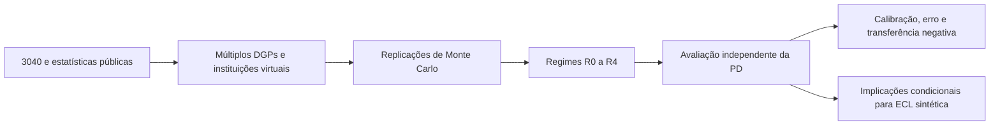

# Modelagem adaptativa de probabilidades de inadimplência com Machine Learning

**Experimentos de transferência entre carteiras sintéticas e implicações para a mensuração de perdas esperadas de crédito.**

Projeto de dissertação em Controladoria e Contabilidade, PPGCONT/UFRGS, linha Usuários Externos. Base científica: **proposta v5 — 14/11/2026**. Documentos dependentes e apresentação alinhados à v5 em **15/11/2026**.

> Proposta para discussão com a orientação. Não há resultados, o simulador não existe, o protocolo não está congelado e a mini revisão sistemática da literatura não foi executada. O código é um esqueleto experimental.

## Questão de pesquisa

Em que condições a disponibilidade de dados locais, a heterogeneidade entre carteiras de origem e destino e a complexidade dos algoritmos influenciam a qualidade das estimativas de PD produzidas por estratégias de Machine Learning com transferência e adaptação?

O desenho corrente usa simulação de Monte Carlo e instituições virtuais, com PD verdadeira conhecida sob múltiplos mecanismos geradores. O Documento 3040 orienta a estrutura; SCR.data e, quando útil, IF.data apoiam a calibração agregada. Compara R0 referência ingênua, R1 local, R2 agrupado, R3 transferido e R4 transferido com recalibração, usando logística regularizada e gradient boosting quando aplicáveis. A repercussão em ECL é sintética e condicional às premissas de LGD, EAD e desconto. Validação com dados reais é complementar, não pré-requisito do desenho principal. A ferramenta comercial permanece fora do escopo.

## Documentos correntes

- [Proposta v5](docs/proposta/proposta-dissertacao-v5-2026-11-14.md): desenho científico corrente, ainda sujeito à orientação.
- [Roadmap v5](docs/roadmap-dissertacao-ecl-ml-v5.md): etapas E01–E12 e critérios de passagem.
- [Parecer sobre a v3](docs/parecer/parecer-metodologico-v3-2026-11-14.md): avaliação que motivou a v4, com quadro de atendimento.
- [Protocolo experimental v5](docs/metodologia/protocolo-experimental-v5.md): ADEMP preliminar do desenho sintético; a congelar antes das simulações confirmatórias.
- [Protocolo operacional da mini RSL Q0–Q6](docs/revisao/protocolo-busca-wos-q0-q6.md): buscas, seleção e rastreabilidade sob a v5.
- [Notas normativas](docs/normativo/notas-verificacao-normativa.md), [dicionário de dados](data_dictionary/README.md) e [configuração ilustrativa](configs/experimento-exemplo.yaml).
- [Apresentação](docs/index.html): proposta v5 em modo documento e modo apresentação, com justificativa das escolhas metodológicas e grafo de referências.
- [Registro de 15/11](docs/registro-atualizacao-2026-11-15.md): alinhamento dos documentos à v5 e verificações.

## Pendências que condicionam a qualificação

1. Execução da mini revisão sistemática; a lacuna é candidata.
2. Séries, períodos e segmentos do SCR.data para a calibração agregada.
3. Versão do leiaute 3040 e congelamento do dicionário.
4. DGPs, parâmetros e sua proveniência; horizonte fixo ou trajetórias mensais.
5. Replicações, margens de adequação e de irrelevância, dimensionadas por piloto.
6. Aproximação estática ou versão descontada da ECL sintética.

Lista completa na seção 11 da proposta v5.

## Mini RSL

Q0 faz o mapeamento; Q1–Q2 constituem o núcleo científico; Q3–Q4 sustentam simulação e calibração; Q5 sustenta a discussão contábil; Q6 reúne métodos gerais. Uma única revisão delimitada, ainda não executada.

- [Registro de buscas](docs/revisao/registro-buscas.md) e [fluxo PRISMA](docs/revisao/fluxo-prisma.md).
- [Organização bibliográfica e planilhas](literature/README.md), separadas de `data/`.
- [Relatório da incorporação](docs/revisao/registro-incorporacao-2026-11-15.md).

## Histórico

As propostas [v1](docs/proposta/proposta-dissertacao-v1-2026-10-28.md), [v2](docs/proposta/proposta-dissertacao-v2-2026-11-06.md) e [v3](docs/proposta/proposta-dissertacao-v3-2026-11-13.md), o [parecer de 05/11](docs/parecer/parecer-metodologico-v1-2026-11-05.md), o [protocolo v3](docs/metodologia/protocolo-experimental-v3.md) e o [registro de 13/11](docs/registro-atualizacao-2026-11-13.md) permanecem nos caminhos originais e contêm formulações superadas. O [acervo histórico](docs/historico/README.md) indica como recuperar cada estado anterior. O [CHANGELOG](CHANGELOG.md) resume a evolução.

A [proposta v4](docs/proposta/proposta-dissertacao-v4-2026-11-14.md), o [protocolo experimental v4](docs/metodologia/protocolo-experimental-v4.md), o [registro de 14/11](docs/registro-atualizacao-2026-11-14.md), os [protocolos de busca v3/v4](docs/metodologia/mini-revisao-protocolo-wos-2026-11-14.md), o [adendo v4](docs/revisao/protocolo-revisao-literatura.md) e o [protocolo inicial v5](docs/mini-rsl-wos-ecl-ml-v5.md) foram preservados como antecedentes. Descrevem o desenho com microdados reais, superado pela v5.

## Desenho analítico



## Organização e estado de implementação

`src/ecl_suficiencia/` conserva o nome técnico por compatibilidade. Estão implementados apenas auxiliares aritméticos (produto PD × LGD × EAD, peso heurístico, faixas de atraso e diferenças); estimadores, recalibração, medidas e validação são interfaces com `NotImplementedError`, e o simulador ainda não tem módulo. Veja o [mapa do protótipo](docs/metodologia/prototipo-e-limites.md).

`configs/` descreve o desenho; não existe executor para o YAML. `experiments/` e `notebooks/` estão reservados. `data/` não é versionada.

## Ambiente e apresentação

```powershell
python -m venv .venv
.\.venv\Scripts\python -m pip install -e ".[dev]"
.\.venv\Scripts\python -m pytest
```

Em Linux/macOS, usar `.venv/bin/python`. Os testes verificam apenas os auxiliares existentes.

Abra `docs/index.html` no navegador. Para reconstruir: `python docs/apresentacao/build.py`. A fonte e as instruções estão em [docs/apresentacao](docs/apresentacao/README.md).

## Licenças e citação

Código sob [MIT](LICENSE). Textos e apresentação sob [CC BY 4.0](docs/LICENSE-CC-BY-4.0.md). As licenças não concedem direitos sobre dados de terceiros. Metadados em [CITATION.cff](CITATION.cff).
