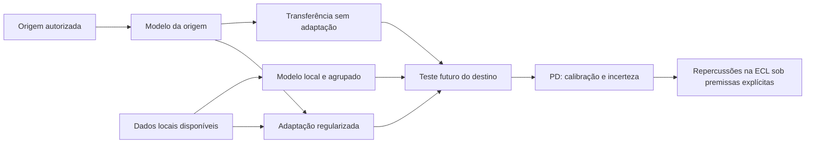

# Modelagem adaptativa de perdas esperadas de crédito com Machine Learning

**Disponibilidade de dados e heterogeneidade entre carteiras de instituições financeiras brasileiras.**

Projeto de dissertação em Controladoria e Contabilidade, PPGCONT/UFRGS, linha Usuários Externos. Versão documental **0.3.0 — 13/11/2026**.

> Proposta para discussão com a orientação. Não há resultados empíricos nem acesso a microdados confirmado. O código é um esqueleto experimental, não um motor de ECL validado.

## Questão central

Em que condições de disponibilidade de dados locais e heterogeneidade entre carteiras estratégias adaptativas de Machine Learning produzem estimativas confiáveis de probabilidade de inadimplência, e como essas estimativas se refletem na mensuração de perdas esperadas de crédito em instituições financeiras brasileiras?

O estudo compara modelos locais, agrupados, transferidos sem adaptação e adaptados, avaliando calibração, qualidade probabilística, discriminação, estabilidade e incerteza. A disponibilidade será medida pelos dados efetivos; **S4/S5 não são sinônimos de poucos dados**. Recursos operacionais entram como viabilidade secundária. A plataforma comercial é uma aplicação posterior da pesquisa.

## Documentos correntes

- [Proposta v3](docs/proposta/proposta-dissertacao-v3-2026-11-13.md): título, problema, questão, objetivos, H1–H3, método, ECL, cronograma e limitações.
- [Apresentação](docs/index.html): síntese interativa da proposta, com navegação por setas, modo contínuo e exemplo ilustrativo de propagação da PD.
- [Protocolo experimental](docs/metodologia/protocolo-experimental-v3.md): regras a congelar antes dos experimentos, contrastes e critérios de viabilidade.
- [Notas normativas](docs/normativo/notas-verificacao-normativa.md): correção da referência à Resolução BCB 309/2023 e aplicação da 352/2023, com fontes e pendências.
- [Dicionário de dados](data_dictionary/README.md) e [configuração ilustrativa](configs/experimento-exemplo.yaml).
- [Registro da revisão](docs/registro-atualizacao-2026-11-13.md): mudanças, rastreabilidade, preservação e verificações.

## Histórico e referências preservadas

As [propostas v1](docs/proposta/proposta-dissertacao-v1-2026-10-28.md) e [v2](docs/proposta/proposta-dissertacao-v2-2026-11-06.md), assim como o [parecer de 05/11](docs/parecer/parecer-metodologico-v1-2026-11-05.md), permanecem intactos. Contêm formulações superadas e interpretações normativas corrigidas na v3; não são as instruções correntes do projeto.

A apresentação anterior, notas e demais documentos substituídos têm [cópias integrais e manifesto de integridade](docs/historico/README.md). O [CHANGELOG](CHANGELOG.md) conserva a evolução das versões.

## Desenho analítico previsto



A validação separa treino, adaptação e teste, considera transferência negativa e preserva prevalência no teste. `PD × LGD × EAD` é um auxiliar aproximado: a mensuração contábil pode exigir múltiplos períodos, cenários, desconto e recuperações. Diferença experimental em relação a um nível regulatório não determina lançamento contábil.

## Organização e estado de implementação

`src/ecl_suficiencia/` conserva o nome técnico por compatibilidade. Há auxiliares aritméticos implementados para produto PD/LGD/EAD, peso heurístico, faixas de atraso e diferenças; os estimadores, adaptação, validação e motor multiperíodo ainda são interfaces com `NotImplementedError`. As faixas e a diferença positiva não implementam integralmente as regras do BCB. Veja [o mapa do protótipo](docs/metodologia/prototipo-e-limites.md).

`configs/` descreve o desenho; ainda não existe executor para o YAML. `experiments/` e `notebooks/` estão reservados. Dados privados em `data/` não devem ser versionados nem compartilhados externamente. Identificadores com hash podem continuar sendo dados pseudonimizados.

## Ambiente e apresentação

```powershell
python -m venv .venv
.\.venv\Scripts\python -m pip install -e ".[dev]"
.\.venv\Scripts\python -m pytest
```

Em Linux/macOS, usar `.venv/bin/python`. Os testes atuais verificam apenas os auxiliares existentes; não validam a proposta empiricamente nem demonstram conformidade normativa.

Abra `docs/index.html` no navegador. Para reconstruir no Windows: `python docs/apresentacao/build.py`; em Git Bash, com `python3` disponível: `bash docs/apresentacao/build.sh`. A fonte e as instruções estão em [docs/apresentacao](docs/apresentacao/README.md). Nenhuma publicação remota é necessária para consultar o arquivo.

## Licenças e citação

Código sob [MIT](LICENSE). Textos e apresentação sob [CC BY 4.0](docs/LICENSE-CC-BY-4.0.md). As licenças do repositório não concedem direitos sobre dados de terceiros. Metadados em [CITATION.cff](CITATION.cff).
