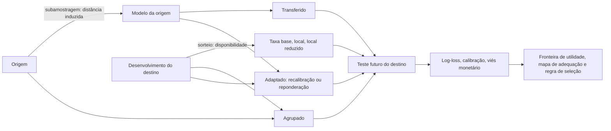

# Modelagem adaptativa de perdas esperadas de crédito com Machine Learning

**Transferência de modelos de probabilidade de inadimplência, disponibilidade de dados e heterogeneidade entre carteiras de instituições financeiras brasileiras.**

Projeto de dissertação em Controladoria e Contabilidade, PPGCONT/UFRGS, linha Usuários Externos. Versão documental **0.4.1 — 14/11/2026**.

> Proposta para discussão com a orientação. Não há resultados empíricos nem acesso a microdados confirmado, e a mini revisão sistemática da literatura não foi executada. O código é um esqueleto experimental.

## Questão de pesquisa

Como a disponibilidade de dados locais, a heterogeneidade entre carteiras de origem e de destino e a complexidade do algoritmo afetam, em comparação com modelos locais e agrupados, a qualidade das probabilidades de inadimplência de 12 meses estimadas por estratégias adaptativas de Machine Learning em carteiras de crédito de instituições financeiras brasileiras?

Qualidade designa pontuação probabilística, calibração e viés monetário. O estudo compara sete regimes (taxa base, local, local reduzido, agrupado, transferido, adaptado por recalibração e adaptado por reponderação) com dois algoritmos em paridade (regressão logística regularizada e gradient boosting), manipula por sorteio o volume de dados locais e a distância entre origem e destino e classifica cada combinação como adequada, inadequada ou inconclusiva segundo critério fixado antes do teste. Dessa classificação deriva uma regra de seleção de regime conforme a informação disponível. A teoria de base é a representação fidedigna da informação contábil para o usuário externo.

A dissertação entrega o método validado e um protótipo reprodutível. A ferramenta de mensuração para instituições com pouca informação própria ou pouca capacidade de modelagem é aplicação posterior, fora do escopo.

## Documentos correntes

- [Proposta v4](docs/proposta/proposta-dissertacao-v4-2026-11-14.md): problema, questão, objetivos, referencial, hipóteses H1–H5 e contrastes C1–C2, método, cenários de dados e pendências.
- [Parecer sobre a v3](docs/parecer/parecer-metodologico-v3-2026-11-14.md): avaliação que motivou a v4, com quadro de atendimento.
- [Protocolo experimental v4](docs/metodologia/protocolo-experimental-v4.md): decisões a fixar antes do teste, fatores, regimes, medidas e análise.
- [Protocolo de mini revisão sistemática](docs/metodologia/mini-revisao-protocolo-wos-2026-11-14.md) e [consultas Web of Science](docs/metodologia/mini-revisao-queries-wos-2026-11-14.txt): busca, seleção, extração e síntese. O [adendo da v4](docs/revisao/protocolo-revisao-literatura.md) registra a correspondência com a v4, os critérios de refutação da lacuna e a situação de leitura das referências.
- [Notas normativas](docs/normativo/notas-verificacao-normativa.md), [dicionário de dados](data_dictionary/README.md) e [configuração ilustrativa](configs/experimento-exemplo.yaml).
- [Apresentação](docs/index.html): síntese da proposta em slides.
- [Registro da revisão de 14/11](docs/registro-atualizacao-2026-11-14.md): mudanças, decisões e verificações.

## Pendências que condicionam a qualificação

1. Acesso a microdados de contratos.
2. Execução da mini revisão sistemática; a lacuna é candidata.
3. Faixas do critério de adequação, margem de irrelevância e limiar de materialidade.
4. Conferência normativa por instituição e data-base.

## Histórico

As propostas [v1](docs/proposta/proposta-dissertacao-v1-2026-10-28.md), [v2](docs/proposta/proposta-dissertacao-v2-2026-11-06.md) e [v3](docs/proposta/proposta-dissertacao-v3-2026-11-13.md), o [parecer de 05/11](docs/parecer/parecer-metodologico-v1-2026-11-05.md), o [protocolo v3](docs/metodologia/protocolo-experimental-v3.md) e o [registro de 13/11](docs/registro-atualizacao-2026-11-13.md) permanecem nos caminhos originais e contêm formulações superadas. O [acervo histórico](docs/historico/README.md) indica como recuperar cada estado anterior. O [CHANGELOG](CHANGELOG.md) resume a evolução.

## Desenho analítico



## Organização e estado de implementação

`src/ecl_suficiencia/` conserva o nome técnico por compatibilidade. Estão implementados apenas auxiliares aritméticos (produto PD × LGD × EAD, peso heurístico, faixas de atraso e diferenças); estimadores, recalibração, fatores experimentais, medidas e validação são interfaces com `NotImplementedError`. Veja o [mapa do protótipo](docs/metodologia/prototipo-e-limites.md).

`configs/` descreve o desenho; não existe executor para o YAML. `experiments/` e `notebooks/` estão reservados. Dados privados em `data/` não são versionados.

## Ambiente e apresentação

```powershell
python -m venv .venv
.\.venv\Scripts\python -m pip install -e ".[dev]"
.\.venv\Scripts\python -m pytest
```

Em Linux/macOS, usar `.venv/bin/python`. Os testes verificam apenas os auxiliares existentes.

Abra `docs/index.html` no navegador. Para reconstruir: `python docs/apresentacao/build.py`. A fonte e as instruções estão em [docs/apresentacao](docs/apresentacao/README.md).

## Licenças e citação

Código sob [MIT](LICENSE). Textos e apresentação sob [CC BY 4.0](docs/LICENSE-CC-BY-4.0.md). As licenças não concedem direitos sobre dados de terceiros. Metadados em [CITATION.cff](CITATION.cff).
