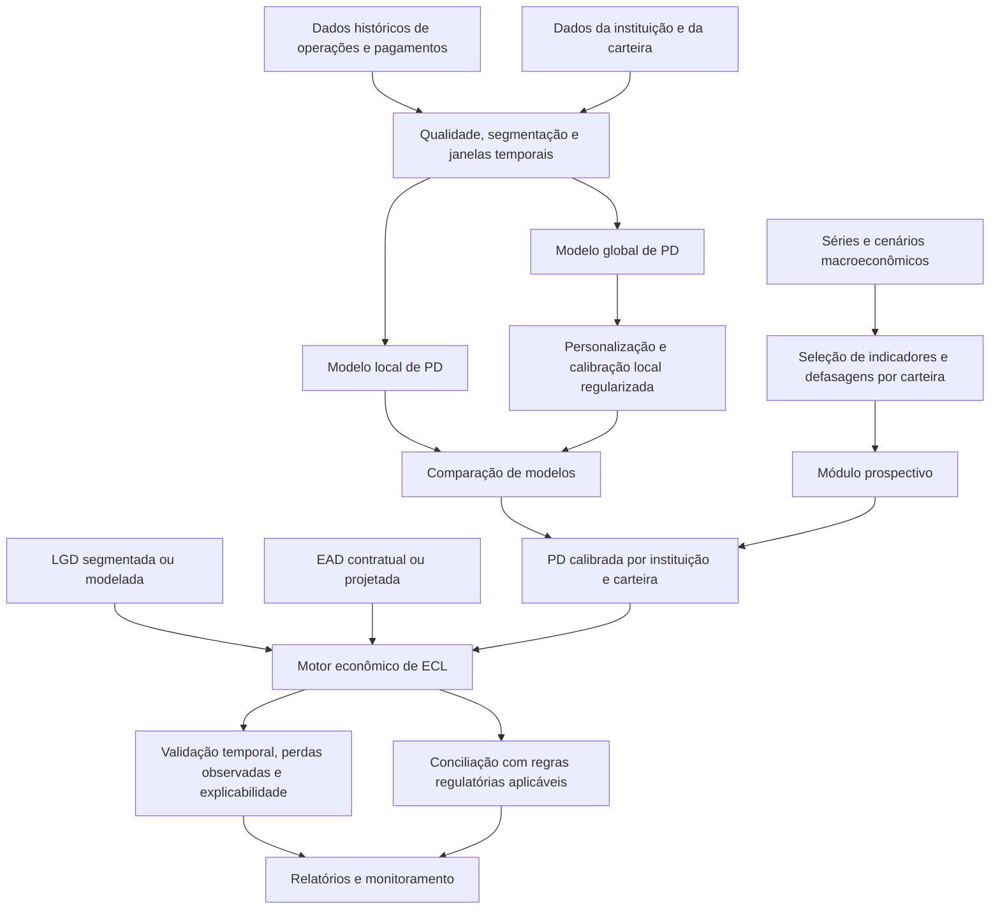

# Proposta de Dissertação de Mestrado

## Personalização e Robustez de Modelos de Machine Learning para Estimação de Perdas Esperadas de Crédito em Instituições Financeiras com Dados Limitados

**Natureza:** projeto preliminar de dissertação em Controladoria e Contabilidade  
**Área:** contabilidade bancária, mensuração de perdas esperadas de crédito, risco de crédito e aprendizado de máquina  
**Versão:** 28 de outubro de 2026  
**Status:** proposta metodológica para discussão com orientação; originalidade e aderência normativa dependem de revisão sistemática e verificação da legislação consolidada.

---

## Resumo da proposta

Esta pesquisa propõe desenvolver e avaliar uma arquitetura modular e adaptativa de aprendizado de máquina (*machine learning*, ML) para estimar perdas esperadas de crédito (*expected credit losses*, ECL), com ênfase em instituições financeiras de menor porte e em contextos de dados históricos limitados. O núcleo empírico será a estimação e a calibração da probabilidade de inadimplência (*probability of default*, PD), comparando modelos globais, modelos locais e modelos híbridos com personalização por instituição e carteira. A arquitetura incorporará informações prospectivas mediante seleção de indicadores macroeconômicos por carteira ou setor, preservando separação entre o motor estatístico e as regras de provisionamento aplicáveis. A perda em caso de inadimplência (*loss given default*, LGD) e a exposição no momento da inadimplência (*exposure at default*, EAD) serão tratadas em módulos proporcionais à disponibilidade de dados, sem pressupor que todas as instituições possam treinar modelos individuais complexos. A avaliação considerará discriminação, calibração probabilística, erro de perdas agregadas, estabilidade temporal, interpretabilidade, custo computacional e robustez a diferentes volumes de dados. A contribuição pretendida não consiste na invenção de um algoritmo novo, mas na produção de evidências sobre as condições em que a personalização e a seleção macroeconômica agregam valor para a mensuração de ECL.

**Palavras-chave:** perdas esperadas de crédito; IFRS 9; Resolução CMN nº 4.966/2021; machine learning; risco de crédito; calibração; escassez de dados; variáveis macroeconômicas.

---

# 1. Introdução

## 1.1 Contextualização

A mensuração de perdas de crédito constitui componente relevante da informação contábil de instituições financeiras, pois afeta os resultados, os saldos patrimoniais e a avaliação da qualidade dos ativos. A IFRS 9 consolidou uma abordagem de perdas esperadas que procura incorporar informações históricas, condições correntes e expectativas razoáveis e sustentáveis sobre o futuro. No Brasil, a Resolução CMN nº 4.966/2021 e a Resolução BCB nº 352/2023 integram o arcabouço regulatório de instrumentos financeiros e provisões para perdas esperadas, com implementação a partir de 2025, observadas as regras de transição e demais disposições aplicáveis.

A literatura tem discutido as limitações do reconhecimento de perdas incorridas e os efeitos das práticas de provisionamento sobre a tempestividade do reconhecimento contábil e a pró-ciclicidade. Estudos sobre ECL desenvolveram abordagens modulares para integrar PD, LGD e EAD, além de procedimentos para incorporar cenários macroeconômicos. Paralelamente, métodos de ML passaram a ser aplicados à previsão de inadimplência e de recuperação de crédito, oferecendo flexibilidade para capturar não linearidades e interações entre variáveis. Esses avanços, contudo, não asseguram que modelos complexos produzam estimativas bem calibradas, estáveis ou operacionalmente viáveis em qualquer carteira.

Instituições de menor porte podem enfrentar desafios específicos: histórico reduzido de contratos, número pequeno de eventos de inadimplência, mudanças rápidas no perfil da carteira, disponibilidade desigual de informações sobre recuperações, capacidade computacional limitada e restrições de equipe especializada. Além disso, uma instituição pode operar carteiras com riscos muito diferentes, como consignado, capital de giro para empresas comerciais ou financiamento agropecuário. Nesse contexto, a escolha de um modelo único e de um conjunto fixo de indicadores macroeconômicos para todos os segmentos pode ser insuficiente; por outro lado, treinar um modelo independente para cada carteira pode amplificar problemas de variância e sobreajuste.

## 1.2 Problema e motivação

A questão central não é demonstrar genericamente que ML supera métodos estatísticos tradicionais. A literatura já explora algoritmos avançados de previsão de crédito e arquiteturas modulares de ECL. A questão é identificar **sob quais condições** modelos adaptativos, com personalização local e seleção de variáveis macroeconômicas, oferecem ganhos reais de calibração e mensuração de perdas em ambientes com dados limitados. O projeto também considera a necessidade de distinguir estimativas econômicas de perdas das provisões contábeis exigidas pelas metodologias regulatórias aplicáveis.

## 1.3 Questão de pesquisa

> Em que condições a personalização de modelos de Machine Learning por instituição e carteira, combinada com a seleção de variáveis macroeconômicas prospectivas, melhora a calibração e a estimação das perdas esperadas de crédito em instituições financeiras de menor porte com históricos limitados?

**Questões complementares:**

1. Modelos globais, locais e híbridos apresentam diferenças relevantes de desempenho conforme o tamanho e a heterogeneidade das bases?
2. A seleção de variáveis macroeconômicas específicas por carteira melhora previsões fora da amostra em relação a um conjunto uniforme de indicadores?
3. Qual é o benefício incremental da personalização após controlar pela calibração e pela complexidade do modelo?
4. Em quais situações um modelo parcimonioso oferece desempenho equivalente ou superior a alternativas mais complexas?
5. Como traduzir estimativas de PD em uma arquitetura operacional de ECL sem confundir o cálculo econômico com a metodologia regulatória de provisão?

## 1.4 Delimitação

O objeto principal será a **PD prospectiva e calibrada**. LGD e EAD integrarão o protótipo de ECL por métodos simples, documentados e compatíveis com a disponibilidade de dados. A modelagem de LGD por ML será uma extensão opcional, condicionada a histórico suficiente de defaults e recuperações. A análise será delimitada a uma ou mais modalidades de crédito com definição homogênea do evento de inadimplência e horizontes de previsão previamente especificados. O projeto não pressupõe que o modelo estatístico substitua automaticamente os critérios regulatórios de provisionamento.

---

# 2. Objetivos

## 2.1 Objetivo geral

Desenvolver e avaliar uma arquitetura modular e adaptativa de Machine Learning para estimação de perdas esperadas de crédito, incorporando personalização por instituição e carteira, seleção de variáveis macroeconômicas prospectivas e mecanismos de calibração, com ênfase na robustez estatística, interpretabilidade e viabilidade de implementação em instituições financeiras de menor porte.

## 2.2 Objetivos específicos

1. Sistematizar a literatura sobre ECL, modelagem de PD e LGD, seleção macroeconômica, calibração, transferência de aprendizado e modelagem com dados limitados.
2. Definir uma base longitudinal de operações e resultados de crédito, com dicionário de dados, evento de default e horizontes de previsão consistentes.
3. Estimar e comparar modelos de referência (regressão logística regularizada) e modelos de ML (por exemplo, XGBoost e Explainable Boosting Machine, conforme viabilidade).
4. Comparar três regimes de treinamento: global, local por instituição/carteira e híbrido com personalização ou calibração local regularizada.
5. Selecionar indicadores macroeconômicos e defasagens por carteira/setor, testando sua contribuição incremental fora da amostra.
6. Examinar a sensibilidade dos resultados ao tamanho da amostra, à frequência de defaults e a mudanças temporais na composição da carteira.
7. Integrar PD, LGD e EAD em um protótipo de estimação econômica de ECL e construir um módulo separado de conciliação com critérios regulatórios aplicáveis.
8. Avaliar discriminação, calibração, erro de perdas agregadas, estabilidade, interpretabilidade, reprodutibilidade e custo operacional.

---

# 3. Hipóteses e expectativas testáveis

**H1 — Personalização:** modelos híbridos com calibração por instituição/carteira apresentam menor erro de calibração e/ou de perdas agregadas do que modelos globais não personalizados, em pelo menos determinados perfis de carteira.

**H2 — Seleção macroeconômica:** indicadores e defasagens selecionados especificamente por carteira geram ganho preditivo fora da amostra em relação a um conjunto macroeconômico uniforme, após controle de complexidade.

**H3 — Escassez de dados:** quando o histórico local é reduzido, modelos híbridos regularizados deterioram-se menos que modelos exclusivamente locais, desde que a base compartilhada seja suficientemente representativa.

**H4 — Parcimônia:** modelos mais simples e interpretáveis podem apresentar calibração e erro de ECL estatisticamente comparáveis aos de algoritmos complexos, com menor custo operacional.

**Nota:** hipóteses são condicionais, falsificáveis e não pressupõem superioridade universal do ML. A verificação de H3 entre instituições exige dados de múltiplas instituições ou desenho de transferência de conhecimento justificável; uma base de instituição única permite apenas uma versão por carteiras/segmentos.

---

# 4. Fundamentação teórica e lacuna de pesquisa

## 4.1 Perdas esperadas e qualidade da informação contábil

Discutir reconhecimento tempestivo de perdas, mensuração prospectiva, qualidade da informação, discricionariedade contábil, pró-ciclicidade e consequências para a gestão de risco. Diferenciar os objetivos de previsão econômica de inadimplência e de conformidade contábil-regulatória. A comparação de valores de provisão não é, por si só, evidência de maior acurácia: é necessário confronto com resultados de crédito posteriormente observados.

## 4.2 Modelagem modular de ECL

A arquitetura de referência decompõe a perda esperada em PD, LGD e EAD. Em aplicações multiperíodo, a PD deve ser tratada de forma temporalmente consistente (probabilidade marginal/condicional, sobrevivência e horizonte), com cenários e desconto quando cabíveis. Schutte et al. (2020) constitui antecedente relevante de modelagem modular; portanto, **modularidade isolada não caracteriza ineditismo**.

## 4.3 ML, calibração e interpretabilidade

Distinguir discriminação (capacidade de ordenar risco) de calibração (adequação das probabilidades). Modelos de árvore podem capturar interações e não linearidades, mas demandam monitoramento e explicação. Avaliar interpretabilidade global e local, estabilidade de importâncias e possibilidade de restrições de monotonicidade quando justificadas economicamente. Não atribuir exigência regulatória universal de monotonicidade sem suporte normativo específico.

## 4.4 Seleção macroeconômica e caráter prospectivo

Breed et al. (2023) fornece referência sobre incorporação de informações macroeconômicas à ECL. Seleção por Lasso/Elastic Net, importância por permutação e modelos parcimoniosos são possibilidades, mas a seleção deve ser conduzida **dentro** das janelas de treinamento. É necessário considerar colinearidade, defasagens, revisões de séries e a disponibilidade efetiva das informações na data de previsão. Importância preditiva não equivale a causalidade.

## 4.5 Personalização e escassez de dados

Distinguir modelo global, local e híbrido. A abordagem híbrida pode combinar padrões gerais com interceptos, efeitos hierárquicos ou recalibração específica por carteira. Transfer learning e aprendizado federado são antecedentes a mapear na revisão, não sinônimos de personalização simples. O ganho esperado decorre de compartilhar informação sem apagar diferenças locais, sujeito à compatibilidade entre populações.

## 4.6 Lacuna científica proposta — sujeita à RSL

A hipótese de lacuna não é a inexistência de modelos de ECL com ML ou de ajustes macroeconômicos. A contribuição a verificar na RSL é a **escassez de evidência empírica integrada** sobre (i) personalização por instituição/carteira, (ii) seleção macroeconômica específica, (iii) calibração de PD e perdas agregadas, e (iv) robustez a dados limitados, no contexto de instituições financeiras menores e da mensuração de ECL. O caráter inédito somente poderá ser afirmado após busca e análise sistemáticas.

---

# 5. Arquitetura conceitual proposta



## 5.1 Camada de dados

- **Instituição:** segmento prudencial, porte, composição da carteira, políticas e mudanças relevantes (quando acessíveis e permitidas).
- **Operação:** modalidade, data de contratação, prazo, saldo, taxa, amortização, garantias, renegociação, dias em atraso e eventos de default.
- **Tomador:** atributos econômicos e cadastrais disponíveis e legalmente utilizáveis; histórico de pagamentos e relacionamento.
- **Carteira/setor:** modalidade, CNAE ou agrupamento setorial, localização em nível adequado, concentração e características das garantias.
- **Macroeconomia:** indicadores de atividade, mercado de trabalho, preços, juros, câmbio e variáveis setoriais, com vintages e defasagens.
- **Recuperação:** fluxos após default, datas, custos e valor de garantias, caso disponíveis.

## 5.2 Módulo de PD

Modelos candidatos: regressão logística regularizada como benchmark; XGBoost ou HistGradientBoosting como modelo não linear; Explainable Boosting Machine como alternativa interpretável. A escolha final será guiada por volume de dados, desempenho e complexidade. Definir PD para horizonte fixo (por exemplo, 12 meses) e, se houver dados mensais adequados, investigar análise de sobrevivência em tempo discreto para horizontes multiperíodo.

## 5.3 Personalização

- **Global:** um modelo treinado com observações combinadas e características de carteira/instituição quando justificadas.
- **Local:** modelos separados por instituição/carteira, sujeitos a amostra mínima.
- **Híbrido:** modelo-base compartilhado com calibração de intercepto/inclinação ou efeitos hierárquicos regularizados por grupo.

Uma especificação ilustrativa é:

\[
\operatorname{logit}(PD_{i,j,c,t}) = f_{\theta}(X_{i,j,c,t}) + \alpha_j + \gamma_c + s_{j,c,t}.
\]

Aqui, \(i\) identifica a operação, \(j\) a instituição, \(c\) a carteira, \(t\) o período, \(f_\theta\) o modelo-base, \(\alpha_j\) e \(\gamma_c\) ajustes regularizados e \(s_{j,c,t}\) o componente prospectivo. Esta é uma **formulação conceitual**, não uma especificação estimada ou validada. Devem ser controlados duplicação de efeitos e identificabilidade.

## 5.4 Seleção e ajuste macroeconômico

Construir conjunto inicial de indicadores economicamente justificáveis e avaliar seleção por carteira com Elastic Net/Lasso e seleção sequencial temporal. Comparar: (M0) sem macroeconomia; (M1) conjunto uniforme; (M2) seleção por carteira; (M3, opcional) variáveis macro diretamente no algoritmo individual. A comparação entre módulos macro separados e inclusão direta é uma questão empírica, não uma escolha definida de antemão.

Exemplo de ajuste sobre log-odds:

\[
PD_{i,t}^{ajustada} = \operatorname{logit}^{-1}\!\left(\operatorname{logit}(PD_{i,t}^{base})+s_{c,t}\right).
\]

O escalar \(s_{c,t}\) poderá ser uma função regularizada de variáveis macroeconômicas e defasagens. Não se deve aplicar ajuste que duplique efeitos macro já presentes na PD-base; a calibração final será reavaliada em amostra independente.

## 5.5 Módulos de LGD e EAD

**LGD essencial:** taxas segmentadas por modalidade, garantia e perfil de recuperação, com critérios explícitos para dados incompletos e censura. **LGD avançada:** regressão/árvores ou sobrevivência para recuperações, apenas quando o histórico permitir. **EAD:** saldo e fluxos contratuais, com ajustes quando houver limites rotativos, pré-pagamento ou comportamento relevante. Os componentes precisam ter horizontes e definições coerentes com a PD.

## 5.6 Integração econômica de ECL

Para ilustração de um único horizonte, \(ECL \approx PD \times LGD \times EAD\). Para uma abordagem multiperíodo, uma representação simplificada é:

\[
ECL = \sum_{s \in \mathcal{S}} w_s \sum_{t=1}^{T}
PD_{t,s}^{marginal} \times LGD_{t,s} \times EAD_{t,s} \times DF_{t,s},
\]

em que \(s\) representa cenário, \(w_s\) sua probabilidade, \(DF\) o fator de desconto e \(PD^{marginal}\) a probabilidade de default no intervalo. A implementação contábil dependerá das definições e requisitos normativos aplicáveis, que não se reduzem necessariamente a essa fórmula.

## 5.7 Camada regulatória independente

O protótipo deve apresentar **duas saídas distintas**: (a) estimativa econômica/modelada de ECL e (b) provisão calculada conforme a metodologia regulatória aplicável, quando as regras e dados necessários forem implementados e verificados. A diferença deve ser tratada como objeto de análise e conciliação, não como autorização automática para contabilizar a estimativa modelada. Atenção especial à segmentação S3/S4/S5 e às condições de utilização de metodologia completa; verificar versões consolidadas das normas e atos de autorização antes da redação final.

---

# 6. Variáveis candidatas

| Bloco | Variáveis candidatas | Justificativa e cuidados |
|---|---|---|
| Operação | prazo, saldo, taxa, garantia, modalidade, idade da operação | Disponibilidade na data-base e risco de vazamento |
| Histórico de crédito | dias em atraso, frequência de atraso, renegociação, comportamento de pagamento | Evitar usar eventos posteriores ao instante da previsão |
| Tomador | porte, setor, indicadores de capacidade financeira, histórico | Qualidade, permissões, viés e representatividade |
| Carteira | modalidade, concentração, setor, região, coorte de originação | Grupos muito pequenos exigem regularização |
| Atividade agregada | IBC-Br, PIB, produção industrial, PMC, serviços | Defasagens de divulgação e revisões |
| Juros e crédito | Selic, spreads e condições de crédito | Efeitos distintos por modalidade e taxa contratual |
| Mercado de trabalho | desemprego, rendimento real, emprego formal | Relevância potencial para crédito a pessoas físicas |
| Inflação | IPCA, índices setoriais | Diferenças entre receita e custo dos tomadores |
| Câmbio e commodities | câmbio, preços agrícolas/industriais | Especialmente em setores expostos a comércio exterior |
| Agro/clima | precipitação, estiagem, preços de insumos | Granularidade espacial, sazonalidade e disponibilidade |
| Construção | SINAPI, atividade setorial, mercado imobiliário | Defasagens e representatividade da carteira |

**Exemplos de fontes a avaliar:** Banco Central do Brasil/SGS, IBGE/SIDRA, Ipeadata, FGV, CEPEA e INMET. A disponibilidade histórica, a licença de uso e a existência de valores conhecidos em cada data de previsão devem ser documentadas.

---

# 7. Desenho metodológico

## 7.1 Natureza da pesquisa

Pesquisa quantitativa, aplicada e explicativa/preditiva, com desenvolvimento de artefato analítico e avaliação empírica comparativa. O estudo poderá ser caracterizado como pesquisa de desenvolvimento e avaliação de modelo, sem reivindicar automaticamente o enquadramento formal em Design Science Research; tal enquadramento dependerá de fundamentação metodológica específica.

## 7.2 Unidade de análise e estrutura dos dados

Preferencialmente contrato-mês ou contrato-trimestre, com identificação de instituição e carteira, informações observáveis no instante \(t\) e rótulo de default no horizonte \(h\). Evitar múltiplas observações do mesmo contrato entre treino e teste que produzam vazamento de informação; implementar divisão temporal e, quando necessário, controles por contrato/coorte.

## 7.3 Definição do evento

Definir default de modo consistente com a finalidade do modelo e a informação disponível: atraso acima de determinado limiar, evento de ativo problemático ou outro critério operacional justificável. Não equiparar automaticamente atraso de 90 dias a toda a definição regulatória de ativo com problema de recuperação de crédito. Documentar curas, renegociações, baixas, cessões e censura.

## 7.4 Amostragem e cenários de disponibilidade

Treinar com 100%, 50%, 25% e 10% da **amostra de treinamento**, preservando integralmente períodos de validação e teste. Adicionalmente, controlar o número de defaults, que pode ser mais relevante do que o número bruto de contratos. Repetir subamostragens com sementes documentadas e intervalos de confiança. A suficiência amostral será avaliada empiricamente; não presumir que um percentual fixo seja suficiente.

## 7.5 Estratégias comparadas

| Eixo | Configurações |
|---|---|
| Algoritmo | regressão logística regularizada; XGBoost; EBM (se viável) |
| Personalização | global; local; híbrido com calibração regularizada |
| Macro | sem macro; indicadores uniformes; seleção por carteira |
| Dados | 10%, 25%, 50%, 100% do treino; diferentes números de defaults |
| LGD | segmentada (principal); ML opcional |

Não é obrigatório estimar todo o produto cartesiano: um plano fatorial reduzido, pré-especificado e coerente com o poder estatístico pode evitar explosão de experimentos.

## 7.6 Treinamento, validação e teste

1. Ordenar dados cronologicamente e estabelecer data de corte.
2. Reservar período final **out-of-time** sem acesso durante desenvolvimento.
3. Realizar validação temporal progressiva (*rolling/expanding window*) nos períodos anteriores.
4. Ajustar imputação, padronização, seleção de variáveis, balanceamento e hiperparâmetros apenas nos conjuntos de treinamento de cada dobra.
5. Usar embargo temporal se os horizontes de previsão se sobrepuserem e houver risco de vazamento.
6. Calibrar probabilidades em janela própria ou com procedimento aninhado, sem utilizar o teste final.
7. Comparar modelos no mesmo período, com incerteza estatística por bootstrap temporal/agrupado quando apropriado.
8. Documentar desempenho por instituição, carteira, coorte, setor e período macroeconômico.

## 7.7 Métricas

**Discriminação:** ROC-AUC e PR-AUC (especialmente com eventos raros).  
**Probabilidade:** Brier Score, log loss, intercepto e inclinação de calibração, gráficos de confiabilidade.  
**ECL:** erro absoluto e relativo de perdas agregadas observadas, viés, estabilidade e, quando possível, erro de fluxos descontados.  
**Robustez:** degradação com menos dados, variação entre períodos, *population stability* e sensibilidade a mudanças de carteira.  
**Interpretabilidade:** estabilidade de variáveis selecionadas, importância por permutação e SHAP quando adequado.  
**Operação:** tempo de treino e inferência, memória, frequência de atualização, número de dependências e documentação necessária.

**Cuidado:** perda realizada é observada com defasagem; períodos sem maturação suficiente não devem ser tratados como ausência de perda. Comparar previsões e resultados com horizontes equivalentes.

## 7.8 Testes estatísticos e ablação

Comparações pareadas em janelas de teste, intervalos de confiança e análise de significância prática. Testes de ablação removerão sucessivamente personalização e seleção macroeconômica para quantificar contribuições incrementais. Reportar também resultados nulos ou desfavoráveis.

## 7.9 Explicabilidade e governança

Documentar linhagem de dados, versões, parâmetros, decisões de seleção, validação, limitações e responsáveis por aprovar retreinamentos. Evitar retreinamento automático sem monitoramento. Estabelecer alertas de degradação e regras para retorno ao modelo anterior. Tratar proteção de dados, confidencialidade e eventuais vieses de forma explícita.

---

# 8. Estratégias conforme disponibilidade de dados

## Cenário A — Dados de múltiplas instituições

**Preferencial para a pergunta original.** Permite testar generalização entre instituições, efeitos hierárquicos e calibração local. Exige acordo de acesso, governança, padronização de definições e verificação de representatividade. Incluir teste *leave-one-institution-out* quando pertinente e metodologicamente viável.

## Cenário B — Dados de uma única instituição com múltiplas carteiras

**Alternativa plenamente possível**, com ajuste explícito da pergunta de pesquisa: personalização por carteira/setor dentro de uma instituição. Não afirmar generalização entre instituições. Testar diferenças entre modalidades e segmentos, inclusive carteiras de menor volume.

## Cenário C — Apenas dados públicos

**Viabilidade condicionada.** Séries agregadas do BCB e do IBGE são úteis para o módulo macroeconômico, mas geralmente não fornecem, por si só, os rótulos contratuais e históricos de recuperação necessários para treinar PD/LGD individualizadas. Bases públicas de crédito estrangeiras podem viabilizar prova de conceito, mas limitam conclusões sobre instituições brasileiras e adequação regulatória local. Caso não haja microdados apropriados, reformular o objeto para modelagem agregada por carteira ou análise metodológica de benchmark.

---

# 9. Relevância e contribuição

## 9.1 Acadêmica

A contribuição pretendida é **empírica e condicional**, não de invenção algorítmica. Busca identificar os limites de utilidade de modelos híbridos personalizados, o valor incremental de seleção macroeconômica e a sensibilidade da calibração a dados escassos. A dissertação conecta métodos de previsão de risco à qualidade da mensuração contábil e ao desempenho das estimativas de perdas agregadas.

## 9.2 Prática

O protótipo poderá oferecer arquitetura reprodutível, com entrada padronizada de dados, modelos parcimoniosos, validação e relatórios de explicabilidade. A adoção real exigirá validação independente, políticas de governança, controles internos e enquadramento normativo apropriado. Não se presume redução de provisão, economia de capital ou aprovação regulatória como resultados necessários.

## 9.3 Regulatória

A pesquisa permite discutir a diferença entre perda econômica modelada e provisão exigida pela metodologia aplicável, inclusive em instituições de menor porte. **Não** pressupõe que S5 possa optar indistintamente pela metodologia completa mediante autorização; o enquadramento exato de S3/S4/S5 e exceções deve ser conferido nos dispositivos vigentes e atos complementares. A Resolução BCB nº 352/2023 e a Resolução CMN nº 4.966/2021 devem ser analisadas em suas versões consolidadas.

## 9.4 Limites do ineditismo

Schutte et al. (2020) já tratam de arquitetura modular; Breed et al. (2023) abordam informações macroeconômicas; Joubert et al. (2021) investigam LGD. A RSL deverá ainda localizar estudos de transferência de aprendizado, personalização, dados limitados e calibração. Portanto, a lacuna é **provisória** até a revisão sistemática demonstrar quais combinações e contextos permanecem insuficientemente investigados.

---

# 10. Plano de revisão sistemática da literatura (RSL)

## 10.1 Perguntas de revisão

- Quais arquiteturas de ML foram utilizadas para estimar PD, LGD e ECL sob IFRS 9 ou CECL?
- Como os estudos incorporam indicadores e cenários macroeconômicos?
- Quais estratégias são utilizadas para bases pequenas, carteiras heterogêneas e personalização entre instituições?
- Como são avaliadas calibração, perdas agregadas, interpretabilidade e custos de implementação?
- Quais estudos tratam de bancos menores, mercados emergentes ou contexto regulatório brasileiro?

## 10.2 Estratégia inicial de busca

Ajustar sintaxe e campos a cada base (Web of Science e Scopus), com testes piloto de sensibilidade. Uma expressão exploratória para WoS é:

```text
TS=(
  ("expected credit loss*" OR "IFRS 9" OR "credit loss provision*" OR "loan loss provision*")
  AND
  ("machine learning" OR "gradient boosting" OR XGBoost OR "transfer learning" OR "hierarchical model*" OR "credit risk model*")
  AND
  ("macroeconomic*" OR "forward-looking" OR calibration OR "small sample*" OR "limited data" OR portfolio*)
)
```

Essa expressão **não deve ser a única busca**: a conjunção dos três blocos pode excluir estudos importantes sobre PD/LGD, aprendizado compartilhado ou seleção macroeconômica. Complementar com consultas por subtema, busca reversa e prospectiva de citações, critérios de inclusão/exclusão e registro do fluxo de seleção.

## 10.3 Matriz de extração

Registrar autor/ano, país, amostra, instituição, modalidade, definição de default, horizonte, algoritmos, variáveis macro, abordagem de personalização, tamanho da amostra, métricas de calibração, validação temporal, resultados, limitações e lacunas. Separar evidências efetivamente encontradas de interpretações do pesquisador.

---

# 11. Protótipo técnico

**Linguagem:** Python.  
**Tratamento:** pandas ou polars.  
**Modelagem:** scikit-learn, XGBoost e, opcionalmente, interpret/glm.  
**Seleção:** Elastic Net/Lasso, validação temporal e importância por permutação.  
**Explicabilidade:** SHAP ou alternativas adequadas ao algoritmo.  
**Interface opcional:** Streamlit.  
**Reprodutibilidade:** configuração declarativa, controle de versão, ambientes fixados e relatórios automatizados.

### Estrutura sugerida

```text
ecl-research/
├── configs/
├── data_dictionary/
├── notebooks/
├── src/
│   ├── ingestion/
│   ├── validation/
│   ├── features/
│   ├── macro_selection/
│   ├── pd_models/
│   ├── local_calibration/
│   ├── lgd_ead/
│   ├── ecl_engine/
│   ├── regulatory_comparison/
│   └── reporting/
├── experiments/
├── tests/
└── docs/
```

### Produtos mínimos

1. Dicionário de dados e critérios de qualidade.
2. Pipeline reproduzível de PD e validação temporal.
3. Comparação global/local/híbrido e macro uniforme/específica.
4. Módulo simples de LGD/EAD e cálculo econômico de ECL.
5. Relatório de desempenho e documentação de limitações.
6. Camada de comparação regulatória apenas após validação dos requisitos aplicáveis.

---

# 12. Cronograma ilustrativo de 12 meses

| Mês | Atividade | Entrega |
|---|---|---|
| 1–2 | RSL, confirmação da lacuna e revisão normativa | protocolo, matriz bibliográfica e problema final |
| 2–3 | Acesso aos dados, dicionário, definições e governança | base analítica e plano de validação |
| 4–5 | Benchmarks e calibração inicial | modelos-base e relatório preliminar |
| 5–7 | Modelos locais/híbridos e seleção macro | experimentos comparativos |
| 7–8 | Testes de escassez e robustez | análise de sensibilidade |
| 8–9 | Integração LGD/EAD e ECL | protótipo econômico |
| 9–10 | Interpretação, análise regulatória e limitações | resultados consolidados |
| 10–12 | Redação, revisão e defesa | dissertação e repositório documentado |

O cronograma deve ser ajustado ao calendário do programa e, sobretudo, ao prazo real de obtenção dos dados.

---

# 13. Riscos e medidas de mitigação

| Risco | Consequência | Mitigação |
|---|---|---|
| Sem acesso a microdados | inviabiliza PD individual | plano alternativo por carteira ou base pública adequada |
| Poucos defaults | estimativas instáveis | regularização, agrupamento, intervalos de confiança, escopo menor |
| Ausência de recuperações | LGD individual inviável | LGD segmentada e limitação explicitada |
| Vazamento temporal | desempenho artificial | janelas cronológicas, vintages e pipeline aninhado |
| Mudança de definição de default | comparações inconsistentes | dicionário de eventos e harmonização |
| Heterogeneidade extrema | transferência prejudicial | testes por grupo e critérios para não personalizar |
| Complexidade excessiva | dissertação inexequível | PD como núcleo; LGD por ML opcional |
| Lacuna já estudada | ineditismo enfraquecido | RSL antes de congelar objetivos e hipóteses |
| Confusão regulatória | conclusão contábil indevida | motor econômico separado do regulatório |
| Privacidade/confidencialidade | restrição de uso dos dados | anonimização adequada, acordos e controles de acesso |

---

# 14. Resultados esperados e critérios de sucesso

Os resultados esperados são condicionais. O estudo deverá identificar se há ganho de personalização, qual a magnitude do ganho, quando a seleção macroeconômica é útil e como o desempenho varia com a disponibilidade de dados. Um resultado nulo — por exemplo, regressão logística bem calibrada igualando XGBoost — também constituirá contribuição relevante, especialmente para instituições menores.

**Critérios mínimos de sucesso da pesquisa:** desenho replicável; dados e eventos definidos; avaliação fora da amostra; métricas de calibração e ECL; comparação de estratégias; incerteza reportada; limitações documentadas; separação explícita entre previsão econômica e obrigação regulatória. **Não** é requisito obter superioridade do ML.

---

# 15. Estrutura sugerida da dissertação

1. **Introdução:** contexto, problema, questão, objetivos, justificativa e delimitações.
2. **Referencial teórico e normativo:** ECL, qualidade da informação, risco de crédito, ML, personalização e macroeconomia.
3. **Revisão da literatura e desenvolvimento das hipóteses:** estudos prévios, lacuna confirmada e modelo conceitual.
4. **Metodologia:** base, definições, modelos, validação, métricas e protocolos de comparação.
5. **Resultados:** modelos, calibração, robustez, seleção macro, personalização e perdas agregadas.
6. **Discussão:** implicações contábeis, limitações, governança, aplicabilidade e diferenças regulatórias.
7. **Conclusões:** resposta à questão, contribuições, limitações e agenda futura.

---

# 16. Referências iniciais (formato APA 7, a conferir)

> **Nota bibliográfica:** lista inicial para orientar a revisão; títulos, metadados, DOIs, versões normativas e dados de publicação devem ser conferidos nas fontes primárias antes da submissão. Não se afirma que esta lista constitua RSL concluída.

Banco Central do Brasil. (2023). *Resolução BCB nº 352, de 23 de novembro de 2023*. Banco Central do Brasil.

Bikker, J. A., & Metzemakers, P. A. J. (2005). Bank provisioning behaviour and procyclicality. *Journal of International Financial Markets, Institutions and Money, 15*(2), 141–157.

Breed, D. G., Hurter, J., Marimo, M., Raletjene, M., Raubenheimer, H., Tomar, V., & Verster, T. (2023). A forward-looking IFRS 9 methodology, focussing on the incorporation of macroeconomic and macroprudential information into expected credit loss calculation. *Risks, 11*(3), Article 59. https://doi.org/10.3390/risks11030059

Bushman, R. M., & Williams, C. D. (2012). Accounting discretion, loan loss provisioning, and discipline of banks’ risk-taking. *Journal of Accounting and Economics, 54*(1), 1–18.

Conselho Monetário Nacional. (2021). *Resolução CMN nº 4.966, de 25 de novembro de 2021*. Banco Central do Brasil.

Global Public Policy Committee. (2016). *The implementation of IFRS 9 impairment requirements by banks: Considerations for those charged with governance of systemically important banks*.

IFRS Foundation. (2014). *IFRS 9 financial instruments*.

Joubert, M., Verster, T., Raubenheimer, H., & Schutte, W. D. (2021). Adapting the default weighted survival analysis modelling approach to model IFRS 9 LGD. *Risks, 9*(6), Article 103. https://doi.org/10.3390/risks9060103

Laeven, L., & Majnoni, G. (2003). Loan loss provisioning and economic slowdowns: Too much, too late. *Journal of Financial Intermediation, 12*(2), 178–197.

Pool, S., de Haan, J., & Jacobs, J. P. (2015). Loan loss provisioning, bank credit and the real economy. *Journal of Macroeconomics, 45*, 124–136.

Schutte, W. D., Verster, T., Doody, D., Raubenheimer, H., & Coetzee, P. J. (2020). A proposed benchmark model using a modularised approach to calculate IFRS 9 expected credit loss. *Cogent Economics & Finance, 8*(1), Article 1735681. https://doi.org/10.1080/23322039.2020.1735681

---

# 17. Decisões pendentes para fechar o projeto

1. **Dados:** acesso a uma ou várias instituições? Há contratos, eventos de inadimplência e recuperações?
2. **Carteira:** uma modalidade homogênea ou múltiplas carteiras comparáveis?
3. **Horizonte:** PD em 12 meses ou curva multiperíodo?
4. **Definição de default:** critério operacional e tratamento de renegociações/cura?
5. **Macroeconomia:** quais indicadores possuem séries suficientemente longas e vintages reconstruíveis?
6. **Escopo regulatório:** qual segmento institucional e qual metodologia efetivamente aplicável?
7. **Lacuna:** o que a RSL demonstrará sobre personalização e ECL com poucos dados?
8. **Viabilidade:** qual é o número de defaults e de períodos disponíveis para validação temporal?

**Decisão metodológica prioritária:** confirmar a disponibilidade e granularidade dos dados antes de comprometer o projeto com aprendizado entre instituições ou LGD individualizada por ML.
