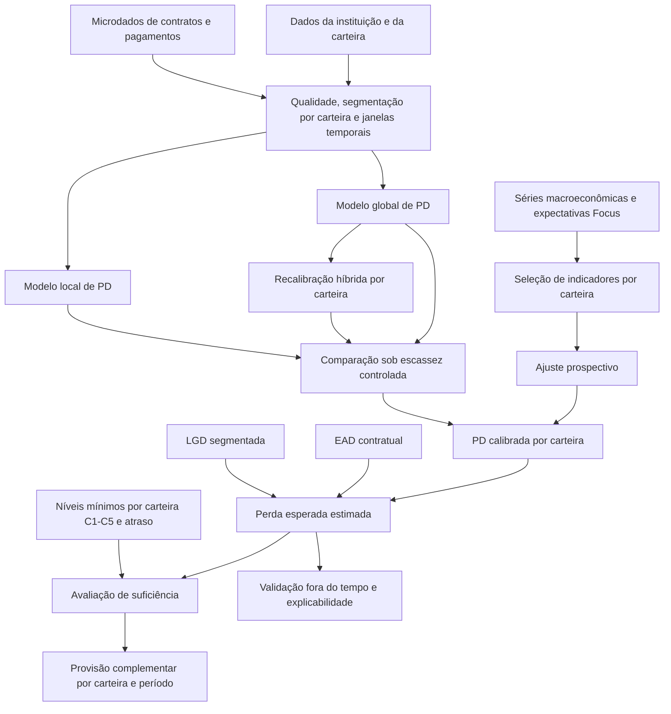

# Proposta de Dissertação de Mestrado

## Estimação de perdas esperadas com dados limitados: modelos de aprendizado de máquina para a avaliação de suficiência da provisão em instituições financeiras dos segmentos S4 e S5

**Natureza:** projeto de dissertação em Controladoria e Contabilidade, linha de pesquisa Usuários Externos
**Área:** contabilidade bancária, mensuração de perdas esperadas de crédito, risco de crédito e aprendizado de máquina
**Versão:** 6 de novembro de 2026 (reformulação da versão de 28 de outubro de 2026)
**Status:** proposta para discussão com a orientação. Os dispositivos normativos citados devem ser conferidos no texto consolidado vigente antes da redação final; as referências bibliográficas listadas devem ter seus metadados confirmados nas fontes primárias.

---

## Resumo

A Resolução CMN nº 4.966/2021 instituiu, a partir de 1º de janeiro de 2025, o regime de perdas esperadas para a provisão de risco de crédito das instituições financeiras brasileiras e determinou que as instituições dos segmentos S4 e S5 apurem a provisão pela metodologia simplificada. Essa metodologia fixa níveis mínimos de provisão por carteira e faixa de atraso, mas exige que a instituição mantenha montantes suficientes para a totalidade da perda esperada e registre de forma segregada a parcela que exceder os mínimos. A obrigação de avaliar a suficiência recai, assim, sobre instituições que dispõem de histórico curto, poucos eventos de inadimplência e equipes reduzidas, sem orientação metodológica detalhada sobre como estimar a perda esperada que serve de referência à comparação. Esta pesquisa propõe estimar a perda esperada de crédito para fins de avaliação de suficiência em instituições S4 e S5 por meio de modelos de probabilidade de inadimplência treinados sob restrição de dados, comparando a regressão logística regularizada com algoritmos de aprendizado de máquina (*gradient boosting* e *Explainable Boosting Machine*) em três regimes de treinamento (global, local e híbrido com recalibração por carteira), com e sem seleção de indicadores macroeconômicos prospectivos por carteira. O desenho experimental controla o número de eventos de inadimplência disponíveis para o treinamento, de modo a identificar em que condições cada estimador produz probabilidades calibradas. Como desdobramento aplicado, a perda esperada estimada é confrontada com os níveis mínimos regulatórios, carteira a carteira e período a período, para mensurar a magnitude e a tempestividade da provisão complementar. A contribuição é metodológica, ao oferecer um desenho de avaliação de estimadores em regime de poucos eventos, empírica, ao medir quando a personalização e a seleção macroeconômica agregam calibração, e contábil, ao evidenciar em que carteiras e fases do ciclo os níveis mínimos se afastam da perda esperada estimada.

**Palavras-chave:** perdas esperadas de crédito; Resolução CMN nº 4.966/2021; metodologia simplificada; avaliação de suficiência; aprendizado de máquina; calibração; dados limitados; instituições financeiras de menor porte.

---

# 1. Introdução

## 1.1 Contextualização

A substituição do modelo de perda incorrida pelo de perda esperada alterou a natureza da provisão para risco de crédito. Sob a Resolução CMN nº 2.682/1999, a provisão decorria de uma classificação de risco por níveis com percentuais fixos; sob a IFRS 9 e, no Brasil, sob a Resolução CMN nº 4.966/2021, a provisão passa a refletir uma estimativa de perdas futuras que incorpora informação histórica, condições correntes e previsões razoáveis e sustentáveis. A literatura contábil atribui a essa mudança o potencial de antecipar o reconhecimento de perdas e de reduzir a pró-ciclicidade do crédito, ao mesmo tempo em que amplia o espaço de julgamento do preparador (Beatty & Liao, 2014; Novotny-Farkas, 2016; López-Espinosa et al., 2021). A qualidade da estimativa de perda esperada tornou-se, em decorrência disso, determinante direta da qualidade da informação contábil sobre a carteira de crédito.

O arcabouço brasileiro introduziu uma particularidade que não existe na implementação europeia da IFRS 9. A Resolução CMN nº 4.966/2021 prevê metodologia completa para as instituições dos segmentos S1 a S3 e metodologia simplificada para as dos segmentos S4 e S5, facultando a estas últimas, apenas no caso do S4 e mediante autorização prévia do Banco Central do Brasil, a adoção da metodologia completa (art. 50). A regulamentação dos níveis mínimos de provisão, delegada ao Banco Central pelo art. 67, IV, estabeleceu percentuais por carteira (C1 a C5) e por faixa de atraso. Esses percentuais, contudo, são pisos. A norma infralegal exige que a provisão corresponda a montantes suficientes para fazer face à totalidade da perda esperada e que a parcela da perda esperada que exceder a soma dos níveis mínimos seja registrada de forma segregada, com revisão no mínimo mensal (Resolução BCB nº 309/2023, arts. 11, 13, 14 e 15, conforme a minuta aprovada pelo Voto BCB 60/2023; redação vigente a conferir).

Essa combinação cria um problema prático e científico. As instituições S4 e S5, em sua maioria cooperativas de crédito singulares, sociedades de crédito e financiamento e outras entidades de pequeno porte, são obrigadas a avaliar mensalmente se os níveis mínimos bastam para cobrir a perda esperada de suas carteiras. Para isso precisam de uma estimativa de perda esperada, e portanto de um modelo, ainda que não estejam autorizadas a substituir os mínimos por ele. Dispõem, no entanto, de histórico reduzido, de poucos eventos de inadimplência, de carteiras heterogêneas (consignado, capital de giro, crédito rural) e de capacidade técnica limitada. A norma não detalha como a estimativa de referência deve ser produzida nesse contexto, e a literatura de modelagem de risco de crédito, como se argumenta a seguir, foi construída para bases amplas e para a discriminação entre bons e maus pagadores, não para a calibração do nível de perda em carteiras com poucos eventos.

## 1.2 Problema de pesquisa

O problema não é demonstrar que algoritmos de aprendizado de máquina superam métodos estatísticos tradicionais; essa comparação já foi feita extensamente em bases amplas (Lessmann et al., 2015; Gunnarsson et al., 2021). O problema é identificar qual estimador de perda esperada uma instituição S4 ou S5 consegue usar, com os dados de que efetivamente dispõe, para cumprir a avaliação de suficiência com probabilidades calibradas, e o que essa estimativa revela sobre a adequação dos níveis mínimos regulatórios às suas carteiras. Duas questões técnicas estão embutidas. A primeira é se o compartilhamento de informação entre carteiras ou instituições, por meio de modelos híbridos com recalibração local, reduz o erro de calibração quando o histórico local é curto, como prevê a teoria de estimação com agrupamento parcial. A segunda é se a seleção de indicadores macroeconômicos específicos por carteira melhora a previsão fora da amostra ou, ao contrário, sobreajusta séries temporais curtas.

## 1.3 Questão de pesquisa

> *Em que condições, definidas pelo número de eventos de inadimplência disponíveis e pela heterogeneidade entre carteiras, modelos de probabilidade de inadimplência com personalização por carteira e seleção de indicadores macroeconômicos prospectivos produzem estimativas calibradas de perda esperada para a avaliação de suficiência da provisão em instituições financeiras brasileiras dos segmentos S4 e S5?*

**Questões complementares**

1. Como o erro de calibração de modelos globais, locais e híbridos varia com o número de eventos de inadimplência no treinamento e com a heterogeneidade entre carteiras?
2. A seleção de indicadores macroeconômicos por carteira melhora a previsão fora da amostra em relação a um conjunto uniforme, após controle da complexidade do modelo?
3. Em que condições a regressão logística regularizada produz estimativas equivalentes às de algoritmos de *gradient boosting*, dispensando infraestrutura mais complexa?
4. Em que carteiras e em que fases do ciclo de crédito a perda esperada estimada excede os níveis mínimos da metodologia simplificada, em que magnitude e com que antecedência em relação aos eventos de inadimplência observados? (questão aplicada, que decorre da principal: a estimativa calibrada é a referência que a norma exige para a avaliação de suficiência)

## 1.4 Delimitação

O objeto principal é a probabilidade de inadimplência (PD) calibrada, estimada no nível do contrato e agregada por carteira. A perda em caso de inadimplência (LGD) e a exposição (EAD) integram o cálculo da perda esperada por métodos segmentados e documentados, proporcionais à disponibilidade de dados; a modelagem de LGD por aprendizado de máquina é extensão condicionada à existência de histórico de recuperações. O horizonte de estimação da PD será de doze meses, com extensão a horizontes multiperíodo por análise de sobrevivência em tempo discreto caso a profundidade da base o permita, de modo a cobrir a perda esperada vitalícia exigida para instrumentos com aumento significativo de risco. A população são instituições financeiras dos segmentos S4 e S5 sujeitas à Resolução CMN nº 4.966/2021. A comparação com os níveis mínimos utiliza os percentuais vigentes à data de cada observação. O estudo não propõe substituir os níveis mínimos pela estimativa modelada, e sim produzir e avaliar a estimativa que a norma exige como referência de suficiência.

---

# 2. Objetivos

## 2.1 Objetivo geral

Analisar em que condições, definidas pelo número de eventos de inadimplência e pela heterogeneidade entre carteiras, modelos de probabilidade de inadimplência com personalização por carteira e seleção de indicadores macroeconômicos prospectivos produzem estimativas calibradas de perda esperada para a avaliação de suficiência da provisão em instituições financeiras dos segmentos S4 e S5.

## 2.2 Objetivos específicos

1. Estimar modelos de probabilidade de inadimplência de referência (regressão logística regularizada) e de aprendizado de máquina (*gradient boosting* e *Explainable Boosting Machine*) sob os regimes global, local e híbrido com recalibração por carteira, com validação temporal fora do tempo.
2. Comparar a calibração e o erro de perdas agregadas entre os regimes em função do número de eventos de inadimplência disponíveis no treinamento, mediante subamostragem controlada por número de eventos.
3. Verificar a contribuição incremental, fora da amostra, da seleção de indicadores macroeconômicos prospectivos por carteira em relação a um conjunto uniforme de indicadores.
4. Mensurar a diferença e a defasagem temporal entre a perda esperada estimada e a provisão apurada pelos níveis mínimos da metodologia simplificada, por carteira e por período.

A revisão sistemática da literatura, a construção da base analítica e a documentação do protótipo computacional constam do capítulo de método como procedimentos, e não como objetivos.

---

# 3. Hipóteses

As hipóteses derivam de duas lentes teóricas, apresentadas na seção 4: a teoria de estimação com agrupamento parcial, que prevê o comportamento relativo de modelos globais, locais e híbridos em grupos pequenos, e a teoria da qualidade da informação contábil, que fornece o critério de avaliação da provisão em termos de representação fidedigna e tempestividade.

**H1 (personalização).** Em carteiras com menos de *k* eventos de inadimplência no conjunto de treinamento, modelos híbridos com recalibração por carteira apresentam intercepto e inclinação de calibração mais próximos de (0, 1) e menor erro relativo de perdas agregadas do que modelos globais e locais; a diferença se reduz à medida que o número de eventos aumenta. O valor de *k* será fixado antes da análise, com referência inicial em cinquenta eventos.

**H2 (seleção macroeconômica).** A seleção de indicadores macroeconômicos por carteira produz ganho de log-verossimilhança fora do tempo em relação a um conjunto uniforme apenas quando o número de períodos de treinamento é suficiente para estimar os coeficientes com estabilidade; em séries curtas, a seleção específica não supera, ou piora, o conjunto uniforme.

**H3 (escassez).** A degradação da calibração com a redução do número de eventos, medida pela inclinação da curva erro × eventos, é menor para modelos híbridos regularizados do que para modelos exclusivamente locais, desde que as carteiras compartilhem estrutura de risco compatível.

**H4 (parcimônia).** A diferença de erro relativo de perdas agregadas entre a regressão logística regularizada e o *gradient boosting* situa-se dentro de uma margem de equivalência de ±δ pontos percentuais da provisão, verificada por teste de equivalência (TOST), em carteiras com menos de *k* eventos; a margem δ será fixada com referência em critérios de materialidade contábil.

**H5 (suficiência).** A perda esperada estimada excede os níveis mínimos da metodologia simplificada em carteiras cuja dinâmica de risco difere da média nacional implícita nos percentuais, em especial crédito rural e capital de giro para pequenas empresas, e em fases de piora do ciclo de crédito, e situa-se abaixo deles em carteiras colateralizadas e em fases benignas; a elevação da perda esperada estimada antecede a elevação da provisão mínima em relação aos eventos de inadimplência observados.

As hipóteses são condicionais e falsificáveis. H1, H3 e H4 exigem variação controlada do número de eventos; H2 exige variação do número de períodos; H5 exige a comparação carteira a carteira e período a período com os níveis mínimos vigentes. A verificação de H1 e H3 entre instituições depende de dados de mais de uma instituição; com base de instituição única, essas hipóteses são testadas entre carteiras.

---

# 4. Fundamentação teórica e lacuna

## 4.1 Perda esperada, qualidade da informação e tempestividade

A provisão para perdas esperadas é mensuração contábil cujo propósito é representar fidedignamente a perda de valor da carteira de crédito, de modo relevante e tempestivo para os usuários externos (CPC 00 R2). A literatura empírica mostra que atrasos no reconhecimento de perdas esperadas reduzem a disposição dos bancos a emprestar em recessões (Beatty & Liao, 2011), que a tempestividade da provisão está associada à disciplina sobre a tomada de risco (Bushman & Williams, 2012) e que a transição do modelo de perda incorrida para o de perda esperada está associada a provisões mais tempestivas (López-Espinosa et al., 2021). A comparação entre provisões calculadas por métodos distintos não é, por si, evidência de acurácia; é necessário confrontar as estimativas com os eventos de inadimplência posteriormente observados. Esta pesquisa adota esse critério: a qualidade de uma estimativa de perda esperada é avaliada pela aderência entre a probabilidade prevista e a frequência observada (calibração) e pela antecedência com que a estimativa reage à deterioração da carteira (tempestividade).

## 4.2 Modelagem modular e calibração

A arquitetura de referência decompõe a perda esperada em PD, LGD e EAD, com tratamento temporalmente consistente da PD em aplicações multiperíodo (Schutte et al., 2020; Joubert et al., 2021). A literatura de *credit scoring* distingue discriminação, isto é, a capacidade de ordenar contrapartes por risco, de calibração, isto é, a correspondência entre a probabilidade prevista e a frequência observada. Os benchmarks de referência comparam algoritmos quase exclusivamente por discriminação, em bases com dezenas de milhares de observações (Lessmann et al., 2015; Gunnarsson et al., 2021). Para a provisão, o que importa é a calibração, porque é o nível da probabilidade que se converte em montante provisionado, e a calibração é reconhecidamente a dimensão menos estudada da análise preditiva (Van Calster et al., 2019). Em carteiras com poucos eventos, a calibração é a primeira propriedade a se degradar, problema tratado na literatura prudencial sob a designação de *low default portfolios* (Pluto & Tasche, 2005).

## 4.3 Estimação com agrupamento parcial e o dilema viés-variância

Quando uma população se divide em grupos de tamanhos desiguais, a estimação separada por grupo (agrupamento nulo) produz estimativas de alta variância nos grupos pequenos, e a estimação conjunta (agrupamento completo) produz estimativas enviesadas para os grupos que diferem da média. A teoria de encolhimento mostra que estimadores que combinam as duas abordagens, puxando as estimativas locais para a média global em proporção inversa ao tamanho do grupo, dominam ambas em erro quadrático médio (Efron & Morris, 1975), e os modelos hierárquicos operacionalizam esse princípio (Gelman & Hill, 2007). O mesmo raciocínio se aplica ao dilema viés-variância em aprendizado estatístico (Hastie et al., 2009). Essa teoria prevê o sinal do efeito de personalização em carteiras pequenas, mas não sua magnitude em probabilidade de inadimplência, nem o número de eventos a partir do qual o ganho se anula, nem o que ocorre quando as carteiras têm estrutura de risco distinta. Essas são as quantidades que H1 e H3 se propõem a estimar.

## 4.4 Informação macroeconômica prospectiva e sobreajuste

A incorporação de informação prospectiva à perda esperada é exigência normativa e tem sido operacionalizada por ajustes macroeconômicos sobre a probabilidade de inadimplência (Breed et al., 2023; Moodley et al., 2025). A relação entre indicadores macroeconômicos e inadimplência é estimada no nível carteira-período, com poucas dezenas de observações temporais. Selecionar indicadores e defasagens por carteira multiplica os graus de liberdade do pesquisador sobre uma série curta, o que a teoria estatística associa a sobreajuste e a deterioração fora da amostra. A prática de *overlays* macroeconômicos, por outro lado, assume que a especificidade por carteira captura heterogeneidade real. As duas previsões são incompatíveis e a evidência que decidiria entre elas, em validação temporal estrita, não foi localizada na revisão preliminar. H2 formaliza essa tensão.

## 4.5 Lacuna de pesquisa

A lacuna não é a inexistência de modelos de perda esperada com aprendizado de máquina, nem a ausência de estudos brasileiros. Ela se compõe de três pontos cegos articulados. O primeiro é teórico-metodológico: a literatura de modelagem de risco de crédito avalia estimadores por discriminação em bases amplas, enquanto a avaliação de suficiência exige calibração em regime de poucos eventos, e não há evidência sobre quais estimadores a preservam nesse regime. O segundo é empírico: a teoria de agrupamento parcial prevê que modelos híbridos superem modelos locais em grupos pequenos, mas a magnitude, o limiar de eventos e a sensibilidade à heterogeneidade das carteiras em probabilidade de inadimplência não foram medidos. O terceiro é institucional e contábil: a coexistência, no mesmo sistema financeiro, de níveis mínimos uniformes por carteira com a obrigação de provisionar a totalidade da perda esperada é característica do arcabouço brasileiro, e não há evidência sobre em que carteiras e fases do ciclo os mínimos se afastam da perda esperada estimada. A revisão sistemática descrita na seção 10 verificará esses três pontos antes do congelamento dos objetivos.

---

# 5. Enquadramento normativo

A Resolução CMN nº 4.966/2021 estabelece os conceitos e critérios contábeis para instrumentos financeiros das instituições financeiras e demais instituições autorizadas a funcionar pelo Banco Central do Brasil, com vigência a partir de 1º de janeiro de 2025 para a maior parte de seus dispositivos. O art. 50 determina a metodologia simplificada para as instituições dos segmentos S4 e S5 e para integrantes de conglomerados prudenciais nesses segmentos, e faculta às instituições do S4, mediante prévia autorização do Banco Central, a metodologia completa. O art. 67, IV, delega ao Banco Central a fixação de níveis mínimos de provisão, considerando atrasos, natureza do instrumento e garantias. A Instrução Normativa BCB nº 487/2024 regula o pedido de autorização das instituições do S4, exigindo, entre outros requisitos, a comprovação de uso das perdas esperadas na gestão de crédito há pelo menos dois anos (art. 6º), validação independente e documentação dos modelos de PD, LGD e cenários prospectivos.

Os níveis mínimos constam da Resolução BCB nº 309/2023. Conforme a minuta aprovada pelo Voto BCB 60/2023, o art. 11 fixa percentuais de perda incorrida para operações inadimplidas, aplicáveis a todas as instituições (Anexo I), e o art. 13 fixa percentuais de provisão adicional para as instituições que adotam a metodologia simplificada, por carteira C1 a C5 e faixa de atraso (Anexo II), além de percentuais para ativos com problema de recuperação de crédito não inadimplidos. Ambos os artigos exigem montantes suficientes para fazer face à totalidade da perda esperada. O art. 14, III, exige o registro segregado da parcela da perda esperada que exceder a soma dos níveis mínimos, e o art. 15 exige revisão no mínimo mensal. A redação vigente desses dispositivos, inclusive eventual consolidação em ato posterior, deve ser conferida antes da redação final.

Para a pesquisa, três consequências decorrem desse enquadramento. Primeira, a estimativa de perda esperada é obrigação das instituições S4 e S5, e não opção, o que define o usuário da pesquisa. Segunda, a comparação entre a perda esperada estimada e os níveis mínimos é a operação que a norma exige, o que define a variável contábil de interesse (a parcela complementar). Terceira, o Banco Central declarou que os percentuais serão revisados periodicamente, o que define o interesse do regulador na evidência produzida. A Resolução BCB nº 352/2023, citada na versão anterior desta proposta, aplica-se a corretoras, distribuidoras, corretoras de câmbio, administradoras de consórcio e instituições de pagamento, e não integra o arcabouço das instituições financeiras aqui estudadas.

---

# 6. Desenho da pesquisa

## 6.1 Natureza e delineamento

Pesquisa quantitativa, de finalidade preditiva e avaliativa, com delineamento quase-experimental computacional. As configurações de modelagem (algoritmo, regime de personalização, conjunto macroeconômico e número de eventos de treinamento) são manipuladas pelo pesquisador sobre dados observacionais de crédito, e o desempenho é mensurado em período fora do tempo. O estudo segue o protocolo de benchmarks comparativos em risco de crédito (Lessmann et al., 2015), com as adaptações exigidas pela validação temporal e pelo foco em calibração. O protótipo computacional é instrumento de pesquisa, não objeto.

## 6.2 Arquitetura analítica



## 6.3 Módulo de PD e regimes de personalização

Os modelos candidatos são a regressão logística regularizada (referência), o *gradient boosting* em árvores (XGBoost ou LightGBM) e, conforme viabilidade, o *Explainable Boosting Machine* (Nori et al., 2019). Três regimes são comparados. No regime global, um único modelo é treinado com as observações de todas as carteiras, sem identificadores de grupo. No regime local, um modelo é treinado por carteira, sujeito a número mínimo de eventos. No regime híbrido, o modelo global é recalibrado por carteira em um segundo estágio, por regressão logística do evento sobre o logit da PD global (intercepto e inclinação), com encolhimento dos coeficientes para (0, 1) em proporção inversa ao número de eventos da carteira. Essa especificação em dois estágios evita a duplicação de efeitos de grupo que ocorreria se o modelo-base incluísse identificadores de carteira. A formulação conceitual é

logit(PD_ic) = a_c + b_c · logit(PD_global(X_i)) + s_c(t),

em que *i* indexa o contrato, *c* a carteira, *a_c* e *b_c* são os parâmetros de recalibração encolhidos e *s_c(t)* é o componente prospectivo da seção 6.4.

## 6.4 Módulo macroeconômico prospectivo

O componente *s_c(t)* é estimado no nível carteira-período, sobre a diferença entre a taxa de inadimplência observada e a prevista pelo modelo-base, como função regularizada (Elastic Net) de indicadores macroeconômicos e suas defasagens. Quatro configurações são comparadas: M0, sem componente macroeconômico; M1, conjunto uniforme de indicadores para todas as carteiras; M2, seleção por carteira; M3, opcional, variáveis macroeconômicas incluídas diretamente no modelo de PD. A seleção é feita exclusivamente dentro das janelas de treinamento. Para assegurar que apenas informação disponível na data de previsão seja usada, as variáveis prospectivas serão as expectativas de mercado do sistema Focus do Banco Central, que constituem por construção a informação disponível em cada data, complementadas por realizações defasadas de séries do SGS e do IBGE com respeito ao calendário de divulgação.

## 6.5 LGD, EAD e perda esperada

A LGD será segmentada por modalidade, tipo de garantia e perfil de recuperação, com tratamento explícito de censura e de dados incompletos; a modelagem de LGD por regressão ou sobrevivência fica condicionada à existência de histórico de recuperações. A EAD corresponderá ao saldo contábil e aos fluxos contratuais, com ajustes para limites rotativos quando houver. A perda esperada por contrato em horizonte de doze meses é o produto PD × LGD × EAD; na extensão multiperíodo, a soma descontada das perdas marginais ao longo do prazo esperado, conforme a formulação padrão da literatura (Schutte et al., 2020).

## 6.6 Avaliação de suficiência

Para cada carteira e período, a perda esperada estimada é agregada e comparada com a provisão apurada pelos níveis mínimos vigentes, obtida pela aplicação dos percentuais por carteira C1 a C5 e faixa de atraso ao saldo de cada operação. A diferença, quando positiva, corresponde à provisão complementar que a norma exige registrar de forma segregada. São calculadas três medidas: a razão entre perda esperada estimada e provisão mínima; a parcela complementar em percentual da carteira; e a defasagem, em meses, entre a elevação da perda esperada estimada e a elevação da provisão mínima, medida em relação aos eventos de inadimplência observados nos doze meses seguintes.

## 6.7 Unidade de análise, evento e estrutura dos dados

A unidade de análise é o contrato-mês, com identificação de instituição e carteira, variáveis observáveis na data-base e rótulo de inadimplência nos doze meses seguintes. O evento será definido de forma operacional e documentada, com referência inicial em atraso superior a noventa dias ou caracterização como ativo com problema de recuperação de crédito, sem equiparação automática entre os dois critérios. Curas, renegociações, baixas, cessões e censura serão tratadas em dicionário de eventos.

## 6.8 Validação temporal e escassez controlada

Os dados são ordenados cronologicamente. Os últimos doze meses são reservados como período fora do tempo, inacessível durante o desenvolvimento. Nos períodos anteriores, a validação é progressiva (janela expansiva), e toda transformação, seleção de variáveis e ajuste de hiperparâmetros ocorre apenas nos conjuntos de treinamento de cada dobra. A escassez é controlada por número de eventos de inadimplência no treinamento (referência inicial: 25, 50, 100, 200 e total), e não por percentual de observações, com repetições por sementes documentadas e intervalos de confiança por bootstrap agrupado por contrato e período.

## 6.9 Plano fatorial e métricas primárias

O plano fatorial reduzido compreende algoritmo (logística, *gradient boosting*) × regime (global, local, híbrido) × macro (M0, M1, M2), em dezoito células, cada uma avaliada nos níveis de escassez. O EBM e a configuração M3 são extensões. Cada hipótese tem uma métrica primária pré-especificada, registrada no repositório antes da análise: intercepto e inclinação de calibração e erro relativo de perdas agregadas para H1 e H3; log-verossimilhança fora do tempo para H2; erro relativo de perdas agregadas sob TOST para H4; razão perda esperada/mínimo e defasagem em meses para H5. Métricas secundárias incluem Brier score, PR-AUC, ROC-AUC, estabilidade populacional e importância por permutação. Comparações pareadas entre configurações usam testes de acurácia preditiva do tipo Diebold–Mariano sobre as perdas por período e bootstrap agrupado.

## 6.10 Explicabilidade, governança e ética

Serão documentados linhagem de dados, versões, parâmetros, decisões de seleção, validação e limitações. A explicabilidade será tratada por importância por permutação e, quando adequado, valores SHAP, com atenção à estabilidade das variáveis selecionadas entre dobras. Os dados serão cedidos sob termo de cessão com anonimização de identificadores de contrapartes por função de resumo irreversível, com fundamento no art. 7º, IV, da Lei nº 13.709/2018 (realização de estudos por órgão de pesquisa), e armazenados em ambiente controlado. Por se tratar de dados secundários anonimizados, a submissão a comitê de ética será avaliada com a orientação e com o programa.

---

# 7. Dados necessários

## 7.1 Camadas e granularidade

| Camada | Granularidade | Campos essenciais | Finalidade | Fonte provável |
|---|---|---|---|---|
| Operação | contrato-mês | identificador do contrato; modalidade; data de contratação e vencimento; valor original; saldo devedor; taxa e indexador; sistema de amortização; tipo e valor de garantia; carteira C1 a C5; dias de atraso; estágio; indicadores de renegociação, reestruturação, baixa, cessão e liquidação | variáveis explicativas da PD; EAD; rótulo de evento; aplicação dos níveis mínimos | sistema de core banking; histórico do documento 3040 enviado ao SCR, que padroniza modalidade, vencimentos, atraso e garantias |
| Tomador | tomador-mês | natureza (PF/PJ); porte; CNAE ou ocupação; UF e município; renda ou faturamento declarado quando disponível; tempo de relacionamento; classificação interna | variáveis explicativas; segmentação | cadastro da instituição; documento 3040 |
| Carteira | carteira-mês | modalidade agregada; concentração; composição por garantia; coorte de originação; saldo total | agrupamento para regimes local e híbrido; agregação da suficiência | derivada da camada de operação |
| Instituição | instituição | segmento prudencial; tipo (cooperativa singular, SCFI, banco); sistema cooperativo; UF; políticas de crédito relevantes e datas de mudança | heterogeneidade entre instituições (cenário A) | institucional; IF.data |
| Recuperação | evento-fluxo | data do evento; fluxos recebidos após o evento e datas; custos de recuperação; valor realizado de garantias | LGD segmentada; LGD modelada (extensão) | sistema de cobrança |
| Macroeconomia | mês ou trimestre | Selic; IPCA; IBC-Br; desemprego (PNAD); rendimento real; câmbio; inadimplência agregada por modalidade (SGS); preços agrícolas (CEPEA); precipitação (INMET); expectativas Focus para as mesmas variáveis | componente prospectivo; seleção por carteira | BCB/SGS; BCB/Focus; IBGE/SIDRA; CEPEA; INMET |
| Regulatório | carteira × faixa de atraso | percentuais dos níveis mínimos vigentes em cada data; regras de classificação em C1 a C5 | cálculo da provisão mínima | Resolução BCB nº 309/2023 e alterações |

## 7.2 Requisitos mínimos de volume e profundidade

A profundidade temporal mínima é de trinta e seis meses de posições mensais, dos quais doze são reservados para o teste fora do tempo; sessenta meses são desejáveis para que o componente macroeconômico observe mais de uma fase do ciclo. O número de eventos de inadimplência é a restrição crítica. A literatura de regressão logística recomenda ao menos dez eventos por parâmetro estimado (Peduzzi et al., 1996); para um modelo de referência com dez a quinze variáveis, isso implica entre cem e cento e cinquenta eventos no treinamento de cada modelo local, e o desenho de escassez controlada exige que ao menos uma carteira ultrapasse duzentos eventos para que os níveis inferiores possam ser simulados por subamostragem. Carteiras com menos eventos não são excluídas: são exatamente as que motivam o regime híbrido. Para a LGD segmentada, são necessários ao menos vinte e quatro meses de observação após os eventos para que as recuperações maturem.

## 7.3 Cenários de acesso

**Cenário A, múltiplas instituições.** Preferencial. Um sistema cooperativo (central ou confederação) reúne singulares S4 e S5 com dados padronizados pelo mesmo sistema de informação, o que permite testar H1 e H3 entre instituições e aplicar validação *leave-one-institution-out*. Exige acordo de acesso com a central, padronização de definições e verificação de representatividade.

**Cenário B, instituição única com múltiplas carteiras.** Plenamente viável, com a pergunta ajustada para personalização entre carteiras dentro da instituição. Não permite afirmar generalização entre instituições. Testa diferenças entre modalidades e segmentos, inclusive carteiras de menor volume.

**Cenário C, ausência de microdados brasileiros.** Viabilidade condicionada. Bases públicas estrangeiras de crédito permitem a prova de conceito metodológica (H1 a H4), mas não a avaliação de suficiência (H5), que depende das carteiras C1 a C5 e dos níveis mínimos brasileiros. Nesse cenário, H5 seria reformulada para o nível agregado por modalidade, com as séries de inadimplência do SGS, com perda substancial de granularidade.

## 7.4 Decisão de dados como decisão de projeto

A disponibilidade e a granularidade dos dados devem ser confirmadas até o terceiro mês do cronograma. Caso o cenário A não se concretize, o projeto migra para o cenário B com a pergunta ajustada; caso nenhum microdado brasileiro esteja disponível, o projeto migra para o cenário C e H5 é reformulada. Essa regra de decisão é parte do protocolo e será registrada no repositório.

---

# 8. Produtos, protótipo e cronograma

## 8.1 Produtos mínimos

Dicionário de dados e critérios de qualidade; pipeline reprodutível de PD com validação temporal; comparação global/local/híbrido e macro uniforme/específica sob escassez controlada; módulo de LGD/EAD e cálculo de perda esperada; módulo de avaliação de suficiência por carteira e período; relatório de desempenho, explicabilidade e limitações; repositório documentado.

## 8.2 Protótipo técnico

Python; pandas ou polars para tratamento; scikit-learn, XGBoost ou LightGBM e interpret para modelagem; Elastic Net para seleção; SHAP para explicabilidade; configuração declarativa, controle de versão e ambientes fixados. Estrutura sugerida:

```text
ecl-suficiencia/
├── configs/
├── data_dictionary/
├── src/
│   ├── ingestion/
│   ├── validation/
│   ├── features/
│   ├── macro_selection/
│   ├── pd_models/
│   ├── local_recalibration/
│   ├── lgd_ead/
│   ├── ecl_engine/
│   ├── regulatory_floors/
│   ├── sufficiency/
│   └── reporting/
├── experiments/
├── tests/
└── docs/
```

## 8.3 Cronograma indicativo (doze meses)

| Mês | Atividade | Entrega |
|---|---|---|
| 1–2 | Revisão sistemática; confirmação da lacuna; revisão normativa consolidada | protocolo da RSL; matriz de extração; problema e hipóteses congelados |
| 2–3 | Acesso aos dados; dicionário; definição de evento; decisão de cenário | base analítica; regra de decisão aplicada |
| 4–5 | Modelos de referência; validação temporal; calibração inicial | modelos-base; relatório preliminar |
| 5–7 | Regimes local e híbrido; seleção macroeconômica; escassez controlada | experimentos comparativos (H1 a H4) |
| 7–8 | LGD/EAD; perda esperada; níveis mínimos; avaliação de suficiência | módulo de suficiência (H5) |
| 9–10 | Testes estatísticos; explicabilidade; análise de limitações | resultados consolidados |
| 10–12 | Redação; revisão; defesa | dissertação e repositório |

---

# 9. Riscos e mitigação

| Risco | Consequência | Mitigação |
|---|---|---|
| Sem acesso a microdados | inviabiliza PD individual e H5 | regra de decisão do item 7.4; cenário B ou C |
| Poucos eventos em todas as carteiras | impossibilidade de simular escassez por subamostragem | agrupamento de carteiras; redução dos níveis de escassez; relato explícito |
| Ausência de histórico de recuperações | LGD individual inviável | LGD segmentada com limitação declarada |
| Vazamento temporal | desempenho artificial | janelas cronológicas; expectativas Focus; pipeline aninhado |
| Mudança dos níveis mínimos no período | comparação inconsistente | percentuais vigentes à data de cada observação |
| Heterogeneidade extrema entre carteiras | transferência prejudicial no regime híbrido | critérios de compatibilidade; encolhimento adaptativo; relato por carteira |
| Multiplicidade de comparações | falsos positivos | métrica primária pré-registrada por hipótese; plano fatorial reduzido |
| Confusão entre estimativa e provisão exigida | conclusão contábil indevida | separação explícita entre perda esperada estimada e provisão mínima |
| Confidencialidade | restrição de uso dos dados | anonimização; termo de cessão; ambiente controlado |

---

# 10. Plano de revisão sistemática

As perguntas de revisão são: quais estimadores de PD preservam calibração em bases com poucos eventos; que estratégias de compartilhamento de informação entre grupos (hierárquicas, de transferência, federadas) foram aplicadas a risco de crédito; como estudos de perda esperada sob IFRS 9 ou CECL incorporam e validam informação macroeconômica fora da amostra; e que evidência existe sobre a adequação de pisos regulatórios de provisão em relação a estimativas de perda esperada. As bases são Web of Science e Scopus, complementadas por SPELL e repositórios nacionais. Cadeias exploratórias:

```text
TS=(("probability of default" OR "credit scoring" OR "credit risk") AND calibrat* AND ("small sample*" OR "low default" OR "limited data" OR "few events"))

TS=((hierarchical OR multilevel OR "partial pooling" OR shrinkage OR "transfer learning" OR federated) AND ("credit risk" OR "probability of default" OR "credit scoring"))

TS=(("IFRS 9" OR "expected credit loss*" OR CECL) AND (macroeconomic OR "forward-looking") AND (overfit* OR "out-of-sample" OR "out-of-time" OR "variable selection"))

TS=(("loan loss provision*" OR "expected credit loss*") AND (floor* OR "minimum provision*" OR timeliness) AND (bank* OR "credit union*" OR cooperativ*))
```

SPELL e bases nacionais: ("perda esperada" OR "PCLD" OR "provisão para créditos") AND ("Resolução 4.966" OR "IFRS 9") AND (cooperativ* OR "segmento S4" OR "segmento S5" OR "metodologia simplificada").

---

# 11. Contribuições e impacto

A contribuição teórica consiste em testar, em probabilidade de inadimplência de crédito, as previsões da teoria de agrupamento parcial e a tensão entre especificidade macroeconômica e sobreajuste em séries curtas. A contribuição metodológica é o desenho de avaliação de estimadores sob escassez controlada por número de eventos, com métrica primária pré-registrada e foco em calibração, replicável por outras instituições e pesquisadores. A contribuição empírica são as magnitudes: o ganho de personalização, o limiar de eventos em que ele se anula, o valor incremental da seleção macroeconômica e a razão entre perda esperada estimada e níveis mínimos por carteira e fase do ciclo. A contribuição prática é um procedimento documentado de avaliação de suficiência executável por instituições S4 e S5 com os dados de que dispõem. O impacto esperado, caso as hipóteses se confirmem, é fornecer ao regulador evidência para a revisão dos percentuais mínimos por carteira, às instituições um caminho viável para cumprir a norma e, no caso do S4, para construir o histórico de uso gerencial exigido pela IN BCB nº 487/2024, e à literatura contábil evidência sobre a tempestividade comparada de provisões mínimas e estimadas. Um resultado nulo em H4, isto é, equivalência entre a regressão logística e o *gradient boosting* em carteiras pequenas, também constitui contribuição, ao indicar que a avaliação de suficiência não exige infraestrutura complexa.

---

# 12. Referências iniciais (APA 7; metadados a conferir nas fontes primárias)

Banco Central do Brasil. (2023). *Resolução BCB nº 309, de 28 de março de 2023*. https://www.bcb.gov.br

Banco Central do Brasil. (2024). *Instrução Normativa BCB nº 487, de 5 de julho de 2024*. https://www.bcb.gov.br

Beatty, A., & Liao, S. (2011). Do delays in expected loss recognition affect banks' willingness to lend? *Journal of Accounting and Economics, 52*(1), 1–20.

Beatty, A., & Liao, S. (2014). Financial accounting in the banking industry: A review of the empirical literature. *Journal of Accounting and Economics, 58*(2–3), 339–383.

Breed, D. G., Hurter, J., Marimo, M., Raletjene, M., Raubenheimer, H., Tomar, V., & Verster, T. (2023). A forward-looking IFRS 9 methodology, focussing on the incorporation of macroeconomic and macroprudential information into expected credit loss calculation. *Risks, 11*(3), Article 59. https://doi.org/10.3390/risks11030059

Bushman, R. M., & Williams, C. D. (2012). Accounting discretion, loan loss provisioning, and discipline of banks' risk-taking. *Journal of Accounting and Economics, 54*(1), 1–18.

Comitê de Pronunciamentos Contábeis. (2019). *CPC 00 (R2): Estrutura conceitual para relatório financeiro*.

Conselho Monetário Nacional. (2017). *Resolução CMN nº 4.553, de 30 de janeiro de 2017*. Banco Central do Brasil.

Conselho Monetário Nacional. (2021). *Resolução CMN nº 4.966, de 25 de novembro de 2021* (texto consolidado). Banco Central do Brasil.

Efron, B., & Morris, C. (1975). Data analysis using Stein's estimator and its generalizations. *Journal of the American Statistical Association, 70*(350), 311–319.

Gelman, A., & Hill, J. (2007). *Data analysis using regression and multilevel/hierarchical models*. Cambridge University Press.

Gunnarsson, B. R., vanden Broucke, S., Baesens, B., Óskarsdóttir, M., & Lemahieu, W. (2021). Deep learning for credit scoring: Do or don't? *European Journal of Operational Research, 295*(1), 292–305.

Hastie, T., Tibshirani, R., & Friedman, J. (2009). *The elements of statistical learning: Data mining, inference, and prediction* (2nd ed.). Springer.

IFRS Foundation. (2014). *IFRS 9 Financial instruments*.

Joubert, M., Verster, T., Raubenheimer, H., & Schutte, W. D. (2021). Adapting the default weighted survival analysis modelling approach to model IFRS 9 LGD. *Risks, 9*(6), Article 103. https://doi.org/10.3390/risks9060103

Lei nº 13.709, de 14 de agosto de 2018 (Lei Geral de Proteção de Dados Pessoais). (2018). Diário Oficial da União.

Lessmann, S., Baesens, B., Seow, H.-V., & Thomas, L. C. (2015). Benchmarking state-of-the-art classification algorithms for credit scoring: An update of research. *European Journal of Operational Research, 247*(1), 124–136.

López-Espinosa, G., Ormazabal, G., & Sakasai, Y. (2021). Switching from incurred to expected loan loss provisioning: Early evidence. *Journal of Accounting Research, 59*(3), 757–804. https://doi.org/10.1111/1475-679X.12354

Lu, Y., & Nikolaev, V. V. (2022). Expected loan loss provisioning: An empirical model. *The Accounting Review, 97*(7), 319–346. https://doi.org/10.2308/TAR-2019-0128

Moodley, S., Verster, T., & Raubenheimer, H. (2025). A pragmatic macroeconomic default risk adjustment in developing countries. *South African Journal of Economic and Management Sciences, 28*(1), Article a5958. https://doi.org/10.4102/sajems.v28i1.5958

Nori, H., Jenkins, S., Koch, P., & Caruana, R. (2019). *InterpretML: A unified framework for machine learning interpretability* (arXiv:1909.09223). arXiv.

Novotny-Farkas, Z. (2016). The interaction of the IFRS 9 expected loss approach with supervisory rules and implications for financial stability. *Accounting in Europe, 13*(2), 197–227.

Peduzzi, P., Concato, J., Kemper, E., Holford, T. R., & Feinstein, A. R. (1996). A simulation study of the number of events per variable in logistic regression analysis. *Journal of Clinical Epidemiology, 49*(12), 1373–1379.

Pluto, K., & Tasche, D. (2005). Thinking positively. *Risk, 18*(8), 72–78.

Saavedra, C. A. P. B., et al. (2024). Probability of default for lifetime credit loss for IFRS 9 using machine learning competing risks survival analysis models. *Expert Systems with Applications*, Article 123607. https://doi.org/10.1016/j.eswa.2024.123607 [lista completa de autores e volume a conferir no arquivo disponível]

Schutte, W. D., Verster, T., Doody, D., Raubenheimer, H., & Coetzee, P. J. (2020). A proposed benchmark model using a modularised approach to calculate IFRS 9 expected credit loss. *Cogent Economics & Finance, 8*(1), Article 1735681. https://doi.org/10.1080/23322039.2020.1735681

Van Calster, B., McLernon, D. J., van Smeden, M., Wynants, L., & Steyerberg, E. W. (2019). Calibration: The Achilles heel of predictive analytics. *BMC Medicine, 17*, Article 230.

Vasicek, O. (2002). The distribution of loan portfolio value. *Risk, 15*(12), 160–162.

---

# 13. Decisões pendentes

1. Dados: acesso a um sistema cooperativo (cenário A) ou a uma instituição (cenário B)? Há histórico do documento 3040 e de recuperações?
2. Carteiras: quais modalidades estão presentes e com quantos eventos cada uma?
3. Horizonte: PD em doze meses apenas ou extensão multiperíodo?
4. Evento: critério operacional e tratamento de renegociações e cura.
5. Níveis mínimos: redação vigente da Resolução BCB nº 309/2023 e critérios de classificação em C1 a C5 aplicados pela instituição.
6. Parâmetros pré-registrados: *k* (eventos), δ (margem de equivalência), níveis de escassez.
7. Comitê de ética: necessidade de submissão para dados secundários anonimizados.

**Decisão prioritária:** confirmar a disponibilidade e a granularidade dos dados até o terceiro mês, conforme a regra de decisão do item 7.4.
