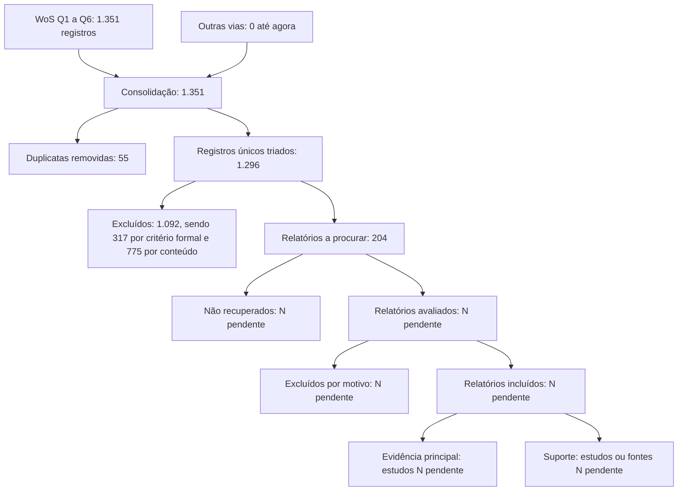

# Fluxo de seleção da mini RSL

**Situação:** Q1–Q6 exportadas em 18/11/2026 e triadas por título e resumo (IA, duas leituras; conferência humana por amostra pendente). Leitura integral pendente. Q0 sem exportação. [Protocolo](protocolo-busca-wos-q0-q6.md) e [registro](registro-buscas.md).

Modelo de relato inspirado no PRISMA, a adaptar ao processo efetivamente executado. Registros bibliográficos, relatórios/publicações e estudos não são unidades intercambiáveis.

## Contagens a preencher

- Identificação WoS por Q e execução: **Q1 49; Q2 199; Q3 456; Q4 67; Q5 80; Q6 500 (total 1.351)**. Q6 completa (500 resultados, confirmado pelo autor).
- Identificação por outras vias, separada por origem: **0 até agora**.
- Duplicatas removidas entre consultas, execuções e vias: **55**.
- Registros únicos triados: **1.296**.
- Excluídos em títulos/resumos: **1.092** (E1 234; E2 14; E3 69; E4 1; M1 34; M2 333; M3 13; M4 315; M5 9; M7 70).
- Relatórios procurados: **204 a procurar** (principal 66; simulação 27; calibração 23; contábil 38; metodológico 50).
- Relatórios não recuperados: **pendente**.
- Relatórios avaliados integralmente: **pendente**.
- Relatórios excluídos por motivo principal (listar cada motivo e N): **pendente**.
- Relatórios incluídos, principais e de suporte: **pendente**.
- Estudos únicos principais (`id_estudo`): **pendente**.
- Estudos/fontes únicos de suporte: **pendente**.

## Reconciliação

Registros identificados = WoS + outras vias. Registros únicos = identificados − duplicatas (registrar separadamente qualquer remoção adicional antes da triagem). Registros únicos = excluídos em título/resumo + relatórios procurados, quando cada registro representar um relatório. Relatórios procurados = não recuperados + avaliados. Avaliados = excluídos com motivo + incluídos. A soma dos motivos principais deve igualar o total excluído integralmente.

Contar XLSX e BibTeX da mesma exportação uma única vez. Relatórios incluídos não equivalem necessariamente a estudos únicos: ligar publicações por `id_estudo`, sem apagar referências. Atribuir categoria principal exclusiva para os totais, conservando múltiplos temas na triagem. Normativos recuperados para contextualização ficam identificados como suporte, fora do total de estudos empíricos. Se fontes adicionais forem rastreadas somente após a triagem, adaptar o fluxo com ramificação própria e manter reconciliação auditável.
