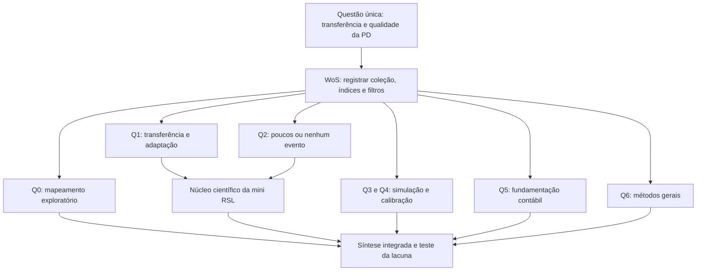
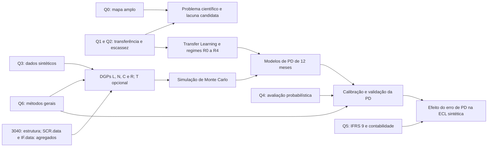
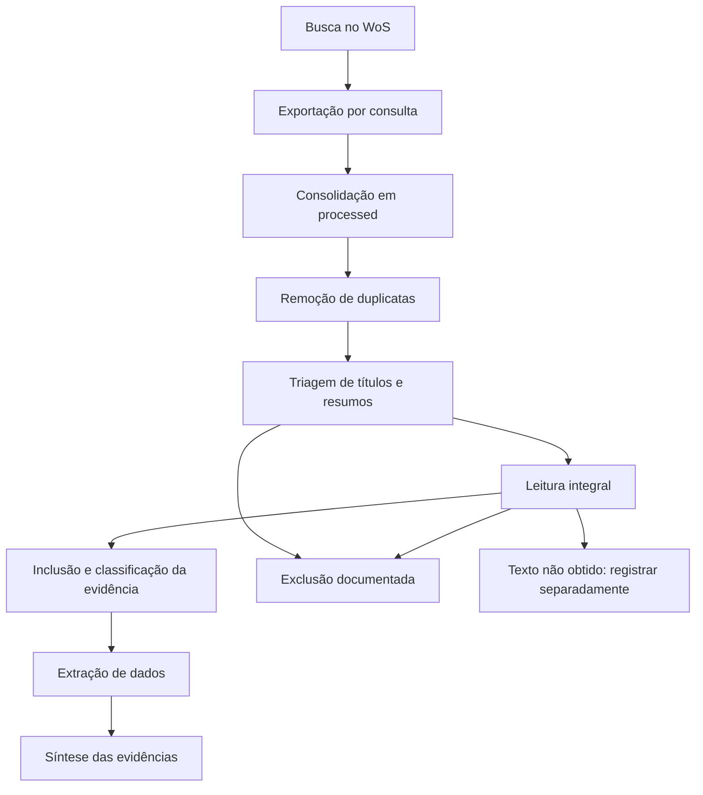

# Protocolo de buscas da mini RSL — Web of Science (Q0–Q6)

**Projeto:** [Proposta v5](../proposta/proposta-dissertacao-v5-2026-11-14.md), articulada à etapa E02 do [roadmap](../roadmap-dissertacao-ecl-ml-v5.md).
**Versão operacional:** 15/11/2026. Este é o protocolo corrente; o [protocolo inicial v5](../mini-rsl-wos-ecl-ml-v5.md) preserva a justificativa e os antecedentes.  
**Natureza:** protocolo operacional de consulta; **nenhuma busca foi executada** neste pacote.  
**Fonte:** estratégia ampla Q0 discutida em 15/11/2026 e consultas Q1–Q6 do protocolo v5 já elaborado.  
**Base-alvo:** Web of Science **Core Collection**, em **Advanced Search / Query Builder**.

> **Atenção:** As strings são candidatas. Teste a sintaxe, o índice e a cobertura na conta institucional; registre literalmente qualquer ajuste. Não invente contagens de resultados nem deduza a recuperação de artigos sem executar as consultas.

## 1. Estratégia geral

A **mini RSL** investiga prioritariamente como transferência, adaptação e escassez informacional afetam a estimação e a calibração de PD em crédito. Os demais eixos oferecem suporte à metodologia e à fundamentação contábil. Q0 é um mapa exploratório, **não substitui Q1–Q2** e não deve ser usado sozinho para alegar exaustividade.

### Diagrama 1 — Estratégia de pesquisa



Q1 e Q2 são independentes de Q0: não intersectar seus resultados com Q0 nem exigir simultaneamente os sete eixos. Q3–Q6 fundamentam o mesmo estudo, sem constituir quatro revisões autônomas.

### Diagrama 3 — Literatura e elementos da dissertação



O desenho corrente usa instituições virtuais e múltiplos DGPs. R0 é a referência ingênua, R1 local, R2 agrupado, R3 transferido e R4 transferido com recalibração. Reponderação é extensão condicionada. Não equiparar agregados de atraso à PD individual nem plausibilidade agregada à validação externa. A ECL permanece desdobramento da PD, sob premissas explícitas de LGD, EAD e desconto. A revisão deve procurar evidências contrárias à lacuna, sem presumir que instituições S4/S5 careçam de dados.

## 2. Consultas para colar no WoS

Para preservar comparabilidade, execute e documente **cada query separadamente**. Não multiplique `AND`s incluindo obrigatoriamente simulação, ECL, Brasil e transferência numa só string.

### Q0 — Mapeamento amplo: risco de crédito e métodos preditivos

```text
TS=(
  ("credit risk" OR "credit scor*" OR "credit default*" OR
   "loan default*" OR "default predict*" OR
   "probability of default" OR "expected credit loss*" OR
   "loan loss provision*")
  AND
  ("machine learning" OR "statistical learning" OR
   "predictive model*" OR "prediction model*" OR
   "risk model*" OR "probabilistic model*" OR
   "transfer learning" OR "domain adaptation" OR
   "synthetic data" OR "Monte Carlo" OR
   "credit risk simulation")
)
```

### Q1 — Transferência e adaptação no crédito (núcleo)

```text
TS=(
  ("credit risk" OR "credit scor*" OR "loan default*" OR
   "credit default" OR "probability of default" OR
   "default prediction" OR "expected credit loss*")
  AND
  ("transfer learning" OR "domain adaptation" OR
   "domain shift" OR "covariate shift" OR
   "cross-domain" OR "cross-portfolio" OR
   "negative transfer" OR "multi-task learning" OR
   "model transportability" OR "model transfer*")
)
```

### Q2 — Poucos ou nenhum default (núcleo)

```text
TS=(
  ("credit risk" OR "credit scor*" OR "probability of default" OR
   "loan default*" OR "default estimation")
  AND
  ("low-default" OR "low default" OR "no-default" OR
   "no default" OR "rare event*" OR "small sample*" OR
   "few-shot" OR "data scarc*" OR "data spars*" OR
   "cold start" OR "limited data")
)
```

### Q3 — Dados sintéticos, DGP e Monte Carlo (suporte)

```text
TS=(
  ("credit risk" OR "credit scor*" OR "loan default*" OR
   "probability of default" OR "expected credit loss*")
  AND
  ("synthetic data" OR "simulated data" OR
   "simulation stud*" OR "Monte Carlo" OR
   "data-generating process*" OR "data generation" OR
   "synthetic portfolio*" OR "credit portfolio simulation")
)
```

### Q4 — Calibração e validação de PD (suporte)

```text
TS=(
  ("credit risk" OR "credit scor*" OR "loan default*" OR
   "probability of default" OR "default prediction")
  AND
  ("probability calibration" OR "model calibration" OR
   "calibration slope" OR "calibration intercept" OR
   "Brier score" OR "log-loss" OR "logarithmic loss" OR
   "proper scoring rule*" OR "calibration curve*")
)
```

### Q5 — IFRS 9, ECL e relevância contábil (suporte)

```text
TS=(
  ("expected credit loss*" OR "IFRS 9" OR
   "loan loss provision*" OR "credit loss provision*" OR
   "credit impairment")
  AND
  ("machine learning" OR "probability of default" OR
   "predictive model*" OR "credit risk model*" OR
   "default forecast*" OR "model calibration")
)
```

### Q6 — Métodos gerais fora do crédito (suporte)

```text
TS=(
  ("transfer learning" OR "domain adaptation" OR
   "covariate shift" OR "negative transfer")
  AND
  ("simulation stud*" OR "Monte Carlo" OR
   "model calibration" OR "probabilistic prediction")
)
```

## 3. Escopo, filtros e critérios

- **Período exploratório candidato:** 2009–2026 (justificar mudanças; exceções metodológicas antigas podem ser recuperadas por citações).
- **Tipos:** Article.
- **Idioma:** apenas inglês.
- **Núcleo empírico:** estudos de crédito/PD com resultados pertinentes a transferência/adaptação, escassez, calibração ou simulação.
- **Suporte teórico:** trabalhos metodológicos externos ao crédito e normativos contábeis entram como contexto, não como evidência empírica de eficácia em carteira bancária.
- **Exclusões:** duplicatas; estudos sem pertinência; textos sem informações suficientes para extração (registrar motivo); estudos somente de fraude ou outros domínios sem ligação justificável.
- **Artigos-semente:** verificar a localização de Suryanto et al. (2022), Kiefer (2009), Blümke (2020). Morris et al. (2019) e Van Calster et al. (2019) podem ser buscados por título/citações como fontes metodológicas, sem exigir presença nas queries de crédito.

## 4. Fluxo de seleção e registro

### Diagrama 2 — Processo de seleção dos estudos



**Planilhas:** `literature/processed/triagem_estudos.xlsx` e `literature/analysis/matriz-extracao.xlsx`. **Documentação:** `docs/revisao/registro-buscas.md` e `docs/revisao/fluxo-prisma.md`.

### Processo de exportação

1. Executar Q0, depois Q1–Q6, mantendo cada consulta identificada separadamente.
2. Registrar índices selecionados, data/hora, cobertura, intervalo, idioma, tipo e número bruto de resultados.
3. Exportar, por query, planilha `.xlsx` e referências `.bib` se estes formatos estiverem disponíveis no seu acesso. **Usar nomes idênticos exceto extensão**, como `wos_Q1_YYYY-MM-DD.xlsx` e `wos_Q1_YYYY-MM-DD.bib`.
4. Colocar arquivos originais sem alterações em `literature/raw/` e lançar seus nomes no registro.
5. Consolidar dados numa **cópia** em `literature/processed/`; manter campo com todas as queries de origem por referência.
6. Deduplicar preferencialmente por DOI normalizado e, na ausência, por título normalizado, ano e autores; conferir casos ambíguos manualmente.
7. Triar título/resumo, e depois texto completo; registrar motivo para exclusões na etapa apropriada.
8. Preencher `literature/analysis/matriz-extracao.xlsx` para os incluídos, separando qualidade metodológica de aderência ao tema.
9. Atualizar fluxograma PRISMA e decidir, com evidências, se a lacuna científica está sustentada, parcialmente coberta ou refutada.

### Dados para extração

Registrar, no mínimo: DOI, título, ano, carteira e população, amostra e eventos, tratamento de poucos/zero defaults, métodos locais/agrupados/adaptativos, diferença entre origem e destino, métricas (calibração, *log-loss*, Brier e AUC), validação temporal, controle de *leakage*, presença de DGP, repetições e erro de Monte Carlo, tratamento de LGD/EAD/ECL, limitações e resultados adversos.

## 5. Preservação e reprodutibilidade

- O arquivo `raw/` é imutável: nova execução recebe nova data, nunca sobrescreva a exportação anterior.
- Não suba informações confidenciais, dados pessoais ou PDFs sem direito de distribuição a repositórios públicos. Verifique eventuais restrições de licença dos metadados exportados.
- Resultados de consultas diferentes podem compartilhar artigos; **não some contagens por query e trate o total como número de artigos únicos**.
- Caso use Zotero, gerencie a biblioteca em Zotero e exporte cópia `.bib` para `literature/references/`, com versão e data identificadas.
- A busca em WoS precisa ser atualizada perto da finalização da redação.
- A revisão da dissertação é mais abrangente que a mini RSL de transferência e adaptação; não alegar exaustividade em áreas não revisadas sistematicamente.

## 6. Fontes metodológicas

- Clarivate — [Search Rules](https://webofscience.zendesk.com/hc/en-us/articles/25350084904721-Search-Rules) e [Core Collection Search Fields](https://webofscience.zendesk.com/hc/en-us/articles/26916258216209-Web-of-Science-Core-Collection-Search-Fields).
- Page et al. (2021), [PRISMA 2020](https://doi.org/10.1136/bmj.n71), como referencial de relato.
- Rethlefsen et al. (2021), [PRISMA-S](https://doi.org/10.1186/s13643-020-01542-z), relato de buscas.
- Morris, White e Crowther (2019), [ADEMP](https://doi.org/10.1002/sim.8086), para estudos de simulação.

**Estado do pacote:** modelos documentais criados; resultados, número de estudos e bibliografia ainda não importados.

## 7. Sintaxe verificada e decisões operacionais

Conferência documental em 15/11/2026 nas páginas oficiais da Clarivate citadas acima: `TS` abrange título, resumo e palavras-chave; `AND` combina blocos, `OR` reúne alternativas. Parênteses explicitam agrupamentos. Aspas delimitam frases e desativam expansão por lematização; `*` representa terminações variáveis e também altera a expansão. Não presumir sinônimos adicionais nas frases entre aspas. As consultas preservam as strings do pacote, com aspas retas e truncamentos à direita. Essa conferência não equivale à aceitação pela interface nem à medição de sensibilidade.

Registrar estado de Exact Search, índices efetivamente acessíveis e campos exportados. O período candidato é 2009–2026 até a data real da execução, sem presumir cobertura futura. Idioma inicialmente sem filtro, sujeito ao piloto; isso amplia a sugestão inglês/português do protocolo inicial. Fixar e justificar a configuração antes da seleção definitiva.

Q6 exige transferência e um bloco de simulação/calibração; não cobre toda a literatura geral desses métodos. Complementar por títulos e citações, identificando a via de descoberta. A rota contábil adicional do [adendo v4](protocolo-revisao-literatura.md) permanece disponível para fundamentação dirigida, com ID próprio, sem reutilizar Q5 antigo.

### Decisões de seleção e síntese

- Classificar pela contribuição do estudo, não apenas pela query: evidência principal exige crédito/PD e transferência/adaptação ou escassez informacional. Estudos somente de simulação, calibração geral ou ECL podem compor suporte.
- Preservar revisões para rastreamento, sem contar seus resultados e os estudos originais como observações independentes. Publicações distintas de um estudo recebem IDs de registro distintos e o mesmo `id_estudo`.
- Pilotar os critérios em um subconjunto real; registrar revisor, data e resolução de dúvidas. Se houver apenas um revisor, declarar essa limitação e revisar decisões duvidosas com a orientação.
- Texto não recuperado não é exclusão por conteúdo. Manter como não obtido no fluxo, registrando tentativas. No texto integral, usar um motivo principal de exclusão por relatório, com justificativa livre.
- Sintetizar métodos, comparadores, dados, qualidade e achados contraditórios. Avaliar separadamente rigor e aderência, sem escala de qualidade presumida validada.
- G1 permanece pendente até a extração e a síntese: lacuna sustentada, parcialmente coberta ou refutada. Ausência de resultados em uma string não prova ausência de literatura.

### Rastreabilidade e arquivos

Usar o [registro de buscas](registro-buscas.md), o [fluxo PRISMA](fluxo-prisma.md), a [triagem](../../literature/processed/triagem_estudos.xlsx) e a [matriz de extração](../../literature/analysis/matriz-extracao.xlsx). As instruções de armazenamento e gerenciamento bibliográfico estão em [literature](../../literature/README.md).

Em exportações parceladas, acrescentar `_lote01`, `_lote02` aos pares de nomes. Para repetição no mesmo dia, acrescentar `_exec02`, preservando o padrão-base e todos os originais. Registrar intervalo de registros de cada lote e quantidade por formato. XLSX e BibTeX da mesma execução são duas representações do mesmo conjunto: não duplicar a contagem PRISMA. Se um formato não estiver disponível, guardar o formato nativo com a extensão correta e registrar a limitação; conversões ficam em processed.
